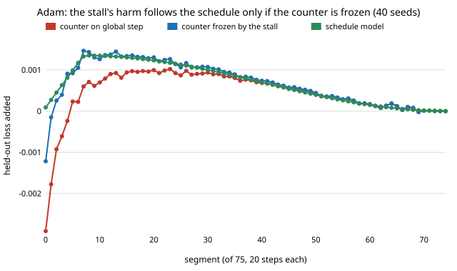

The [verifiable-training-mechanisms](../../research/verifiable-training-mechanisms/)
programme asks how a requester can pay an untrusted worker to train a model and
still get the training done. The worker commits a checkpoint every 20 steps. A
referee replays a few of those segments, and a worker who skipped the steps of
an opened segment is caught. So the referee has to decide which segments to
open.

[Yesterday's step](2026-11-14-verifiable-training-schedule-harm-model.md) found
a simple answer for plain SGD. Skipping a segment costs a fixed amount of
held-out loss (2.7e-4) per unit of learning rate the segment would have used,
wherever the segment sits. A referee can therefore weight its spot checks using
only the published schedule. It flagged one gap: real training uses momentum or
Adam, and with those optimisers the step a segment takes is not the schedule's
learning rate.

## What we predicted, and what happened

We wrote the predictions down before running anything. The setup was the same
small network on the scikit-learn digits data, 40 seeds, four learning-rate
schedules (cosine, step, warmup-cosine and SGDR restarts), and every one of 75
segments stalled in turn. That came to 25,500 stalled training runs in the main
run.

**Momentum: unchanged.** With EMA-form momentum (0.9), harm tracks the
segment's learning rate with correlation 0.995 to 0.998. Plain SGD's constant,
not refitted, predicts the total harm to within 1% to 2%, with 5% to 7% error
per segment. Every momentum prediction held.

**Adam: the prediction failed.** Correlation fell to 0.24 to 0.61. On the
warmup schedule, the first segments did the most harm rather than the least.

## Why Adam broke it

We chose three diagnostics after seeing that failure, so they are post hoc and
labelled that way in the log.

1. **At Adam's best rate, a single stall cannot be measured.** We had picked
   the rate with the lowest honest loss (mean 4e-3). At that rate the harm
   profile from seeds 0 to 19 does not agree with the one from seeds 20 to 39
   (split-half correlation −0.41 to 0.60), because seed-to-seed spread is 3 to
   7 times the mean harm. Skipping one segment there costs less than seed
   noise.
2. **At the standard rate (1e-3), the profile is clear, and it still
   disagrees with the model.** Stalls early in warmup *lowered* the final
   loss.
3. **The bias-correction counter explains it.** Our stall freezes Adam's
   moment estimates but lets the step counter keep counting. Adam's bias
   correction divides the second moment by 1 − 0.999^t, so with the counter
   running ahead, the second moment is under-corrected. After a stall at step
   20 it is about halved, and for roughly the next thousand steps Adam steps up
   to 1.4 times further. Below the optimal rate, that boost repays part of the
   stall. When we reran with the counter frozen as well, the schedule model
   held under Adam: correlation 0.95 to 0.995.

## What it means for a referee

Under momentum, plan spot checks from the schedule exactly as under SGD.
Under Adam, the schedule's weights are right only if the committed optimiser
counter is checked, or once bias correction has faded. In the early segments,
uniform coverage is the safe choice. A worker can also commit a checkpoint
whose counter looks consistent with the step index, so the counter alone does
not reveal the stall.

The limits are the same as before. This is one small MLP on one dataset, with
one momentum setting. The Adam rate we picked sits at the edge of the grid we
searched. We assumed the referee catches every stalled segment it opens, and
did not measure that for these optimisers. The numbers are in
[`results.txt`](../../research/verifiable-training-mechanisms/experiments/optimizer_harm_model/results.txt),
and the plan and outcome are in the programme's
[log](../../research/verifiable-training-mechanisms/LOG.md).
