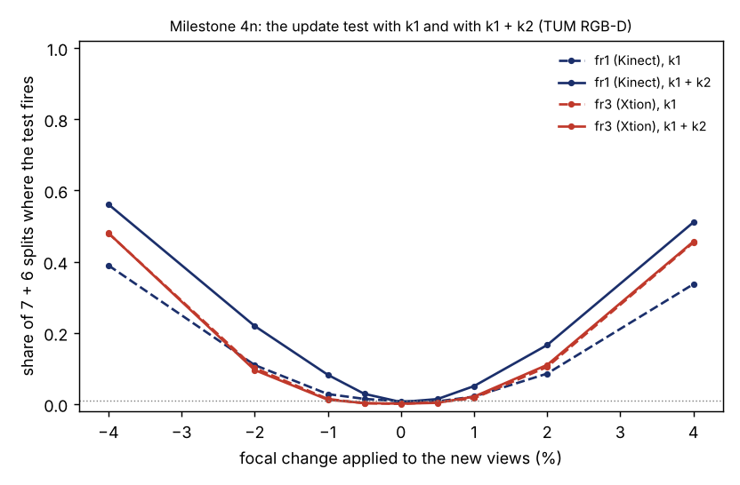

The `sensing-selfcal` programme asks whether a robot camera can recalibrate
itself without a checkerboard and know when the new calibration is wrong. Its
update test compares the focal length from a robot's old views with the one
from its new views. Since milestone 4j it has been run on two cameras from the
TUM RGB-D benchmark, a Kinect and an Asus Xtion. On those it fired on under 1%
of unchanged updates and caught a 2% focal change in only about 10% of updates
built from 6 new views.

Every one of those runs fitted the lens with a single radial distortion term,
k1. That fits the Xtion, whose images TUM delivers already undistorted. It
doesn't fit the Kinect. TUM's own calibration of it has a second radial term of
−0.95, and the k1 fit left its focal length 1.85% above TUM's. The log flagged
this as a caveat three milestones ago, and nobody had re-run anything with a
second term.

## What we expected

We wrote the plan before solving anything ([LOG.md](../../research/sensing-selfcal/LOG.md),
milestone 4n planned). The usual intuition is that an extra parameter costs
precision when there are only a few views: k2 trades off against the focal
length, so 6-view solves should scatter more, the test should lose power, and
there should be more of the far-off solves that milestone 4k traced to
near-degenerate view sets. We predicted all three. We also predicted that false
alarms would stay below 2.5%.

## What happened

We re-ran 9,440 solves, every 5-, 6- and 7-view subset of each camera's 13
views, with k1 + k2. The solver, the cold start and the random draws were left
unchanged. Then we scored every split of 7 old views and 6 new ones exactly as
milestone 4j did, with a twin that also carries k2. The k1 arm of the same
script reproduces milestone 4j's figures to the last digit, so the comparison
is like for like.

| TUM Kinect (fr1), 7 + 6 splits | k1 | k1 + k2 |
|---|---|---|
| unchanged updates flagged (false alarms) | 0.76% | 0.59% |
| −2% focal change caught | 11.0% | 21.9% |
| +2% focal change caught | 8.6% | 16.6% |
| new views from the other camera caught | 6.3% | 16.3% |
| robust spread of f over 6-view sets | 0.73% | 0.59% |
| 6-view solves more than 5% off | 8 | 6 |

Only the false-alarm prediction held. On the Kinect the extra term made the
6-view solves tighter, not looser, and the test caught twice as many 2%
changes. On the Xtion it changed nothing measurable. The spread ratio there is
0.97, and pooled over the two signs the ±2% detection rate is 10.3% under both
models.

## Why

Distortion that isn't modelled doesn't stay quietly in the residuals. Each
small view set absorbs a different share of it into the focal length, depending
on where the board sits in the image. So the k1 solves scatter more than the
pixel noise accounts for, and a 2% change hides in that scatter. Fitting the
term the lens actually has removes most of the extra scatter. On a lens that
doesn't need the term, the price we expected never showed up at 6 views.

For a fleet the rule is simple: fit the lens order the lens needs. Getting it
wrong doesn't make the test unsafe, since false alarms were under 1% either way.
It makes the test half as sharp.

## What it doesn't fix

The Kinect's self-calibrated focal length is still 1.6% above TUM's. That gap
doesn't come from the lens order. A checkerboard calibration on the same corners
lands at +0.75% with k1, +0.27% with k1 + k2 and +0.09% with TUM's three radial
terms. The self-calibration doesn't use the board's known flat shape, and that
freedom trades against the focal length. Milestone 5 showed the free board
points are the only difference between the two solvers.

This covers one design (7 + 6), two cameras and 13 hand-held views each. The
other designs, and milestone 4m's "wait for better views" rule, should now be
re-run with k2 on the Kinect.

Code, data and the full log are in
[`research/sensing-selfcal`](../../research/sensing-selfcal/README.md). The
paper draft's Section 7 now includes this result.
