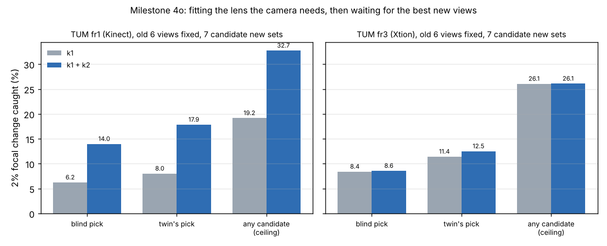

The [`sensing-selfcal`](../../research/sensing-selfcal/README.md) programme asks whether a robot
camera can recalibrate from what it already sees and decide, by itself, when a new calibration
should replace the old one. Two results from earlier today each helped with the second part on
two real RGB-D cameras from the TUM benchmark (fr1, a Kinect, and fr3, an Xtion):

- **Choose your views.** With the old calibration held fixed, a linearised "twin" of the camera's
  own solve can rate candidate sets of new views. Testing the one it rates highest caught a 2%
  focal-length change 1.33× as often as picking one blind.
- **Fit the lens the camera has.** The Kinect's lens is not described by one radial distortion
  term. Adding a second (k1 + k2) doubled the update test's power on that camera, from 9.8% to
  19.3% of updates.

Both were measured on their own. A robot would do both, so the question for milestone 4o was
whether the gains add up, overlap, or cancel.

## What was run

No new bundle adjustment. The stored k1 + k2 solves from the morning cover the two designs that
matter (an old set of 7 views against 6 new, and an old 6 against 6 new with 7 candidate new sets
per old set). The twin was rebuilt with the second lens term, fed the same 10,000 noise draws per
camera as every milestone since 4i, and the morning's ranking and waiting code was imported
unchanged. Six predictions were written into the log before anything was computed. Before reading
the k1 + k2 arm, the k1 arm had to reproduce the earlier figures exactly, and it did (AUC 0.749,
twin level 1.34×, 9.73% chosen against 7.33% blind).

## What came out

All six predictions held.

| TUM Kinect (fr1), 2% focal change | k1 | k1 + k2 |
|---|---|---|
| 6 + 6, blind pick of the new views | 6.2% | 14.0% |
| 6 + 6, the twin's pick | 8.0% | **17.9%** |
| 6 + 6, best of the 7 candidates (ceiling) | 19.2% | 32.7% |
| 7 + 6, top quarter of updates by the twin | 20.3% | 38.9% |
| twin's predicted power ÷ real power, 7 + 6 | 1.34 | 0.995 |
| false alarms of the twin's pick, 6 + 6 | 0.35% | 0.59% |

The gains multiply. Fitting k2 roughly doubles the blind rate, and the twin's choice adds the same
third on top (×1.28), so a robot that does both catches the change 2.86× as often as one that does
neither. False alarms stay below 0.6%. Pooled over both cameras, the twin's pick goes from 9.7%
with k1 to 15.2% with k1 + k2.

The most interesting line is the twin's level. With k1, the twin promised 1.34× more power on the
Kinect than the real test delivered, and earlier milestones put that optimism down to "real focal
lengths vary more than the linear twin says". With k1 + k2 the promise is exact (0.995×). Part of
that extra variation was distortion the one-term model could not fit, which each view set soaked
into its focal length differently, and which a linear model of the k1 solve cannot represent.

It is only part of it. On the Xtion, whose images TUM delivers already undistorted, the second term
changes nothing, and the twin still overstates its power 1.96×. Something else the twin leaves out,
probably per-view effects its residual-pattern noise does not carry, accounts for that.

## What it does not show

Thirteen views per camera, splits and candidate sets that share views, so no confidence interval;
the 28-candidate design could not be re-run because its 4-view sub-solves were never computed with
k1 + k2. A stopping rule over a longer stream of views still needs a bigger view pool than the
13 frames per camera used here.

Code, data and the full log: [`research/sensing-selfcal`](../../research/sensing-selfcal/README.md)
([`experiments/m4o_k2wait`](../../research/sensing-selfcal/experiments/m4o_k2wait/analyse.py),
[`LOG.md`](../../research/sensing-selfcal/LOG.md)).
