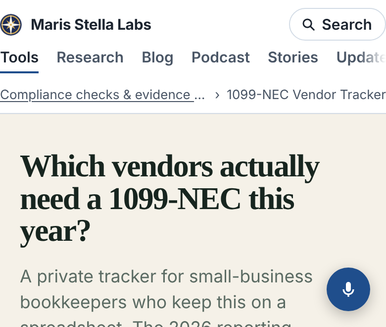
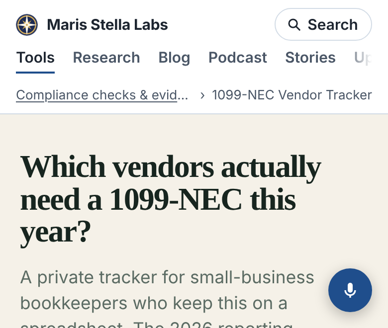

Every tool on the site carries the same header band at the top: the Maris Stella Labs name, the section links, a Search button and a breadcrumb. On a 390 px phone, 61 of the 1,366 tools drew that band with no margin at all. The logo sat at the left edge of the glass, the Search pill at the right, and the breadcrumb started at pixel zero, while the tool's own heading 20 px further in made the misalignment obvious.

The band is inserted as the first thing inside each tool's `<body>`, so its edges are wherever the tool's body puts them. Most tools pad the body, which gives the band a gutter for free. These 61 pad their `main` element instead and leave the body at zero, so the band filled the full screen width. On a desktop the band's row is a centred 1,120 px column, which is why nobody saw it there.

CSS can't ask "how far is my parent from the screen edge?", so the fix happens at build time. The site build already read each tool's inline CSS to see whether the body had top padding. It now also checks for left padding, in inline styles, in the shared base style the generated tools use (`:where(body)`), and in stylesheets the tool links from its own folder. A tool with no side padding gets a `data-pfs-inset` mark on its band. The band's rows then take a 16 px gutter, tapering to none once the screen is wider than the column, so desktop layouts don't move.

Before shipping, the static check was compared with a browser. Across all 1,366 tool pages it flags exactly the 61 that measured under 8 px from the edge, and none of the others. The first version flagged 102 extra pages because it missed the base style and linked stylesheets. After the change, all 61 have a 16 px gutter at 390 px and at 360 px, 60 of them line up with their own heading, and no other page's header moved by a pixel.

Next on the list: at desktop width, 87 tools still have a content column that doesn't line up with the header's.
