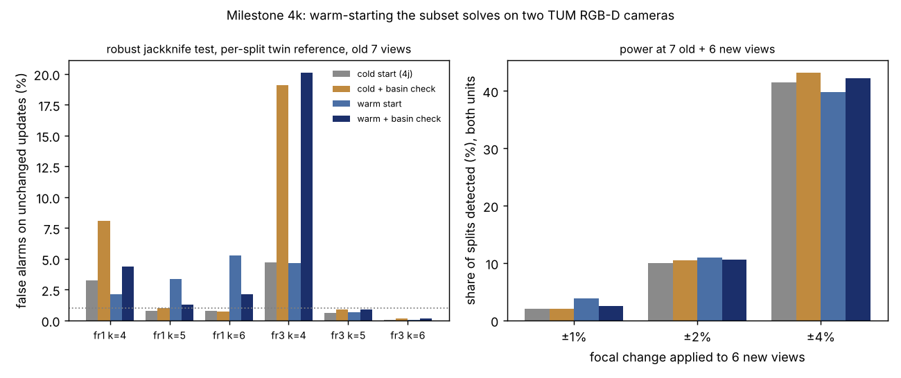

The `sensing-selfcal` programme asks whether a robot camera can recalibrate
itself without a checkerboard and tell when the new calibration is wrong.
Yesterday's step moved the update test to two new cameras, a Kinect and an
Xtion from the [TUM RGB-D benchmark](https://cvg.cit.tum.de/data/datasets/rgbd-dataset).
The false-alarm rate held up there, but the power fell from 33% to 10%. Part of
the blame went to the solver: started cold, at 1.3× a rough focal length, it
sometimes landed far from the answer. One 6-view solve gave f = 9,289 px for a
camera whose true f is about 530 px. The log ended with a guess: "the far solves
could be removed by a warm start or a basin check."

Today's run tested that guess, with the predictions written down before any
solve ran. Every subset of 3 to 7 views was solved again, 11,442 solves in all,
this time starting from the focal length a fleet would know from its spec sheet
(527.1 px, the mean of TUM's two published values). A second arm also threw
out any solve more than 10% from that spec.

All five predictions were refuted:

- **The warm start reproduced every far solve.** All 38 of them, the 9,289 px
  one included, came back at the same focal length, to within 0.01%. On
  the Xtion the far solves fit their corners as well as the full 13-view
  calibration does (rms 0.071 px against 0.075 px). These are not convergence
  failures. The views in those sets barely constrain f, so the cost surface is
  flat along it and its true minimum can sit far away.
- **On the Kinect the spec start was worse.** Starting from the right focal
  length did not start the rest of the problem (poses, board shape, principal
  point, distortion) well. The full 13-view solve got stuck at f = 508.9 px with
  three times the residual (0.48 px against 0.15 px), and so did 5–6% of the
  6–7-view sets. The cold start never lost to it on a set of 6 or more views.
- **The basin check did harm.** Dropping solves outside ±10% of the spec pushed
  the test's false alarms with 4 new views from 4.7% to 20% on the Xtion. The
  test's error bar is a robust jackknife: it widens when one view's removal
  swings f a long way, and the basin check removed exactly those swings. The
  sets that survive look more certain than they are.
- **Power did not move.** A 2% focal change from 6 new views was still caught
  in about 10–11% of splits.

So the drop from 33% to 10% belongs to the cameras' views, not to the solver.
Hand-held 640×480 captures pin the focal length down less tightly than
OpenCV's tutorial photos, and no choice of starting point can add information
the views lack. For anyone building a fleet recalibration check, the practical
version is short. Run the solve from several starts and keep the lowest cost.
Don't clip the focal length to a window around the spec. And treat a wide
delete-one spread as information the test needs, not noise to filter out.

The next step changes direction. If some view sets barely constrain f, the
test should know which ones before it runs. The programme's linearised twin
already computes, for every subset, how strongly its views pin f down. Using
that to choose or weight the old and new sets is the next pre-registered
milestone.

Code, stored solves and the full log:
[`research/sensing-selfcal`](../../research/sensing-selfcal/) (milestone 4k in
[`LOG.md`](../../research/sensing-selfcal/LOG.md); the paper draft's Section 7
now has the result). TUM RGB-D is CC BY 4.0 (Sturm et al., IROS 2012).
