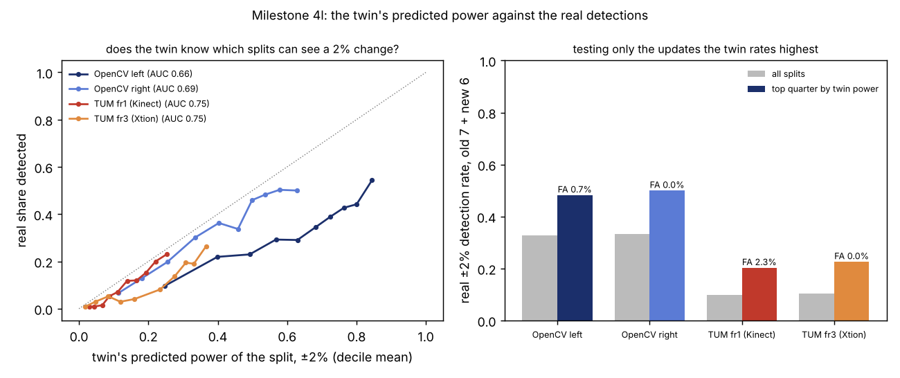

The `sensing-selfcal` programme asks whether a robot camera can recalibrate
itself without a checkerboard and tell when the new calibration is wrong. The
last two steps ended on a sobering note. On two cameras from the
[TUM RGB-D benchmark](https://cvg.cit.tum.de/data/datasets/rgbd-dataset), a
Kinect and an Xtion, the update test kept its false alarms low, but it caught a
2% focal-length change in only 10% of updates built from 6 new views, against
33% on OpenCV's tutorial cameras. Then
[the previous run](2026-11-15-the-far-solves-were-the-data.md) showed this was
not the solver's fault. Some sets of hand-held views just don't pin the focal
length down, and no starting point fixes that.

A robot can't make its views more informative after the fact. What it can do
is decide which updates to test, or wait for better views. This run checked
whether the camera's own "twin" knows enough to make that call. The twin is a
linearisation of the camera's 13-view calibration, and the test already uses
it to set each update's threshold. Fed the same simulated noise with a 2%
focal change added, it gives a predicted power for every split of old and new
views. Four predictions were written down before anything was computed, then
scored against the real detections on all four cameras.

What came out:

- **The twin ranks updates usefully, not sharply.** Its predicted power
  separates the updates the real test catches from those it misses with an
  AUC of 0.75 on both TUM cameras, and 0.66 and 0.69 on OpenCV's. The 0.70 bar
  failed on the OpenCV pair, where most updates are informative already.
- **Testing only the top quarter doubles detection on the TUM cameras.** The
  2% change is caught in 21.5% of the updates the twin rates highest, against
  10.0% over all updates. On OpenCV's cameras it rises from about 33% to 48–50%.
  False alarms in that quarter stay at 0–2.3%.
- **The worst sets are flagged.** Every update that contains one of the far,
  near-degenerate solves from earlier milestones (44 updates in all) lands in the
  quarter the twin rates lowest.
- **The cheap version works as well.** Ranking by the twin's predicted spread
  of the focal-length difference, with no simulated thresholds at all, gives
  the same AUC (0.66–0.75).
- **Don't read the number as a promise.** The twin's absolute power is
  1.2–1.9× higher than the real rate on every camera, because the real
  solves vary more than the linear twin expects. With only 4 new views the
  ranking falls apart (AUC 0.42 on the Kinect).

For a fleet, the advice is to use the twin as a gate: compute the predicted
spread for each candidate update, test the well-conditioned ones, and wait for
more views on the rest. Treat the twin's power as a ranking, not a detection
rate. One limit matters here. With 13 views per camera, picking a split also
picks the old calibration set. A robot that holds one old set and waits for
better new views is the next case to measure, and that needs more views per
camera than these sequences give.

Code, per-unit predictions and the full log are in
[`research/sensing-selfcal`](../../research/sensing-selfcal/) (milestone 4l in
[`LOG.md`](../../research/sensing-selfcal/LOG.md); the paper draft's Section 7
and its recommendations now include the result). TUM RGB-D is CC BY 4.0
(Sturm et al., IROS 2012).
