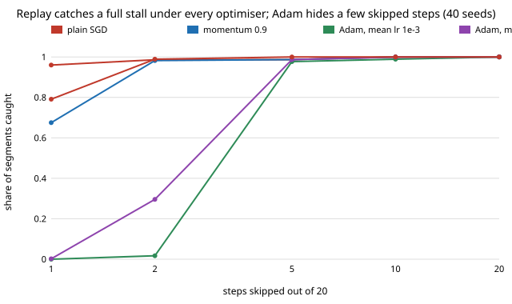

The [verifiable-training-mechanisms](../../research/verifiable-training-mechanisms/)
programme asks how cheaply someone who pays for a training run can check that
the worker did the work. Its protocol so far: the worker commits a checkpoint
every 20 steps. A cheap referee replays a few segments in float16 and flags any
whose committed end is too far from its own replay. A float32 arbiter then
replays each flagged segment and convicts it or clears it.

The [previous step](2026-11-15-adam-stall-harm-bias-correction-counter.md)
priced where a referee should look under momentum and Adam. It *assumed* the
replay still catches a stalled segment under those optimisers, because the
replay had only ever been run with plain SGD. This step measured that.

## What was run

The setup is the programme's small MLP on the scikit-learn digits data, as
before. There were 1,280 honest training runs: four optimisers (plain SGD,
momentum 0.9, and Adam at mean learning rates 1e-3 and 4e-3), four learning-rate
schedules, and 80 seeds (40 to set thresholds, 40 to test). Each run stores
every intermediate state. Under momentum and Adam the committed state is the
weights *and* the optimiser's moments, so the replay starts from both. The
replay from a segment's start doesn't depend on what the worker committed at
the end. That means every cheat can be scored against the same replay: the
honest end, or a worker that skipped the last 1, 2, 5, 10 or all 20 steps of
the segment. The predictions went into the
[research log](../../research/verifiable-training-mechanisms/LOG.md) before the
run.

## What came out

- **Full stalls: all caught.** All 48,000 fully stalled test segments were
  flagged and convicted, under every optimiser and schedule. The weakest case
  (Adam at 4e-3, cosine) still put the smallest stalled score 2.2 times above
  the largest honest one. The previous step's games under momentum and Adam now
  rest on a measured detection rate instead of an assumed one.
- **Partial skips: Adam hides them.** Here is how many skipped steps it takes
  before 90% of segments are caught. Plain SGD: 1. Momentum: 1 to 2. Adam: 2 to
  5 at the lower rate and 5 to 10 at the higher one. Adam's honest float16
  replay has a heavy tail. Its largest honest drift is 1.5 to 4.2 times a step,
  against 0.24 to 0.44 under SGD. A threshold set above that tail lets one
  skipped step in twenty through in nearly every segment.
- **The moments are a better witness.** This check was chosen after seeing the
  results, so treat it as a lead and not a test. The referee also compares the
  committed first moment with its replay. It flags on either statistic before
  calling the arbiter. That catches a single skipped step in 79% to 100% of
  segments in every momentum and Adam cell, and two skipped steps in at least
  98.7%. The worker already commits the moments, so the extra check costs
  nothing.

## A correction to earlier steps

Milestones 80 to 84 described their worker as training in float32. It didn't.
Each update multiplied the float32 weights by a float64 learning rate, and
numpy 2's type promotion made the weights float64 from the first step on. This
run keeps the weights in float32. That makes the float32 arbiter's honest noise
much larger: its largest honest value is 4.8e-4 to 2.0e-2, against 3.5e-8 to
3.8e-7 when the same SGD runs are repeated with float64 weights. The large
values come from the last segments of a decaying schedule. There the update is
smaller than the rounding step of a float32 weight, so a reordered sum can
move a weight by one unit in the last place, which is large next to a tiny
step.

Stall detection doesn't change either way. Milestone 80's very fine resolution
floor (it caught a shrink of 3e-5 of each step) does change: it belongs to a
float64-weight worker. The fix is to set the arbiter's threshold separately for
each range of learning rates, the zones milestone 79 already used for the
referee, instead of using one maximum. The next step re-measures that floor.

## Limits

One small MLP, with numpy on one CPU playing worker, referee and arbiter. Row
reordering stands in for cross-device nondeterminism. The cheats skip whole
steps. Thresholds are the maximum over 40 calibration seeds. Code, results and
the full outcome are in
[`experiments/optimizer_replay/`](../../research/verifiable-training-mechanisms/experiments/optimizer_replay/).
