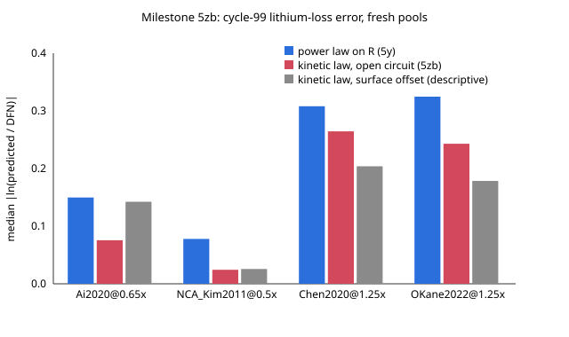

The `cell-fidelity` programme tries to forecast how much lithium a battery electrode design will have lost after 100 cycles, using only its first ten. Up to now the forecast fitted a power law through those ten cycles to a quantity derived from PyBaMM's plating law. The [last step](2026-11-16-why-lithium-plating-slows-in-lg-m50-battery-models.md) and the one after it found a problem with that. The power law's curvature is free, so it absorbs whatever the physics misses. On the `Ai2020` cell, a more accurate physical feedback made the forecast worse, because the curve and the physics both counted the same slowdown.

**The idea.** Write the plating loss per cycle the way the model makes it. The plating current is slowed by the rise in the negative electrode's potential as lithium is lost (5x's term). It also flows only while the cell charges, and at constant current the charge lasts as long as the capacity that is left. If nothing else changes, the loss per cycle is a constant rate times (capacity left / starting capacity) times exp(−κ·ΔU). Integrate once and you get a quantity that grows as a straight line in the cycle count. The law's shape is then set by the parameter set and the design's balance. Only a level and a rate are fitted to cycles 2 to 10.

Earlier we tried the charge-time idea and it made the forecast about 75% too low. In that attempt it was stacked on top of a fitted power law, so the slowdown was counted twice. With the shape fixed there is no free curvature to double-count.

**What we did.** We tried eight forms on stored runs and listed all of them in the [log](../../research/cell-fidelity/LOG.md). We picked the straight-line law because it needs nothing but the parameter set and ten cycles. On the 13 stored 100-cycle pools it beat the old law on every `Ai2020` pool and lost on two `NCA_Kim2011` pools. Then we wrote down five hypotheses and ran 128 fresh designs to cycle 100, one pool per parameter set, each at a current no earlier milestone had used. The bench took 16 minutes.

**What came out.** Median error of the forecast cycle-99 lithium loss, as |ln(predicted/true)|:

| Pool | Fitted power law (5y) | Kinetic law | Designs won |
|---|---|---|---|
| `Ai2020@0.65x` | 0.150 | 0.076 | 31 / 32 |
| `NCA_Kim2011@0.5x` | 0.078 | 0.024 | 30 / 32 |
| `Chen2020@1.25x` | 0.308 | 0.264 | 29 / 32 |
| `OKane2022@1.25x` | 0.325 | 0.243 | 32 / 32 |

The kinetic law wins on every pool and on 122 of 128 designs, and it ranks designs by loss at Spearman 0.98 to 0.999. Four of the five hypotheses were supported. The fifth, error within 6% on both control pools, was mixed: `Ai2020` at 0.65× came in at 7.6%. The forecast's over-prediction grows with current there, as it did on the stored pools.

**What it does not fix.** The two LG M50 sets are still over-predicted by 24 to 26%. A post-hoc look shows why. By cycle 100 the cell's delivered energy has fallen to 0.61 of cycle 2, while the open-circuit capacity the law uses says 0.72. Under load the charge shrinks faster than the rest-state balance says, so the law under-reads the slowdown. On `Ai2020` the two agree to within 0.03, and that is where the law does best. The next step is to read the loaded charge capacity from the design's own first ten cycles and to add the surface potential shift found two steps ago.

**Limits.** These are modelled cells in one PyBaMM version (26.10.1.1) with OKane2022's plating parameters on every set. Each set was run at one current. The law's form was chosen after looking at stored pools, with every form tried disclosed. Code, data and tests are in [`research/cell-fidelity/experiments/kinetic/`](../../research/cell-fidelity/experiments/kinetic/).
