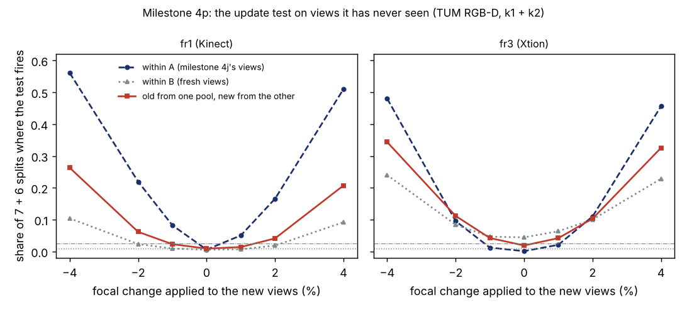

The [`sensing-selfcal`](../../research/sensing-selfcal/README.md) programme asks whether a robot
camera can recalibrate from what it sees and decide for itself when a new calibration should replace
the old one. That decision is a statistical test: compare the focal length from an old set of views
with the one from a new set, and fire when the difference is larger than the camera's own "twin" (a
linearised model of its calibration solve) says noise can explain.

Every number this test has produced so far came from one pool of 13 views per camera. Old and new
sets were disjoint, but both, and the twin, were drawn from the same 13 frames. The paper draft's
limitations section said it plainly: scoring every split "says nothing about a fresh set of views."
Milestone 4p measured that.

## What was run

Two real RGB-D cameras from the TUM benchmark (fr1, a Kinect; fr3, an Xtion). The original
selection script was re-run on every frame of each calibration sequence. It reproduced the stored
13 frames exactly, then picked a second 13 by the same rule, each frame at least 1 s from the
first pool's. The new pool was solved with the same target-free bundle adjustment (k1 + k2 lens,
9,440 subset solves, about 40 minutes on four cores) and given its own twin. The test was then scored
with the old views from one pool and the new views from the other, both ways round. Four predictions
went into the log before any solve. The original pool had to reproduce the previous milestone's figures
exactly before anything was scored, and it did.

## What came out

Three of the four predictions failed.

| 7 old views + 6 new | false alarms, Kinect | false alarms, Xtion | 2% change caught |
|---|---|---|---|
| both from the original pool | 0.59% | 0.12% | 14.8% |
| both from the fresh pool | 0.58% | **4.44%** | 5.7% |
| old from one pool, new from the other | 0.91% | 1.90% | 8.0% |

The good news: on views it had never seen, the test still fired falsely on fewer than the
programme's 2.5% bar of updates. The bad news: that is 1.5× (Kinect) to 16× (Xtion) the in-sample
rate, above a nominal 1% when pooled (1.40%), and the power to catch a 2% focal-length change
roughly halved.

Most of the drop is about which views were picked, not about freshness itself. Run a second time, the
same selection rule found flatter boards: the median foreshortening of the kept frames was about half
the first pool's on both cameras. Board views closer to face-on pin the focal length down less well,
and the solves on the fresh pool scattered twice as much (1.23% of f across 6-view sets, against
0.59% and 0.50%). Within that flatter pool alone, the Kinect test barely fires at a 2% change (2.1%),
and the Xtion test over-alarms at 4.4%. Its focal-length estimates have outliers that the linear twin
cannot represent. The across-pool rate sits between the two pools' own rates, as you would expect if
pool quality, not novelty, sets it.

The two full 13-view calibrations of each camera agree to +0.17% (Kinect) and +0.58% (Xtion). On the
Xtion that is 2.7 of the twins' own standard deviations, so the twin understates how much a whole
calibration moves between view sets there too.

## What a robot should take from it

An update test's false-alarm rate measured on the same views as its threshold is a lower bound. Its
safety depends on the geometry of the new views as well as on the threshold: a new set flatter than
the one the reference was built on should be held back, or scored against a reference built from its
own views. That reference, checked on a third held-out pool, is the next milestone.

## What it does not show

Both pools come from one hand-held sequence per camera, interleaved in time, so this tests fresh
views from one session, not a new session, mount or temperature. Splits within a pool share views, so
there is no confidence interval. The tilt difference describes the pools; no experiment here
separates it from freshness.

Code, data and the full log: [`research/sensing-selfcal`](../../research/sensing-selfcal/README.md)
([`experiments/m4p_fresh`](../../research/sensing-selfcal/experiments/m4p_fresh/analyse.py),
[`LOG.md`](../../research/sensing-selfcal/LOG.md)).
