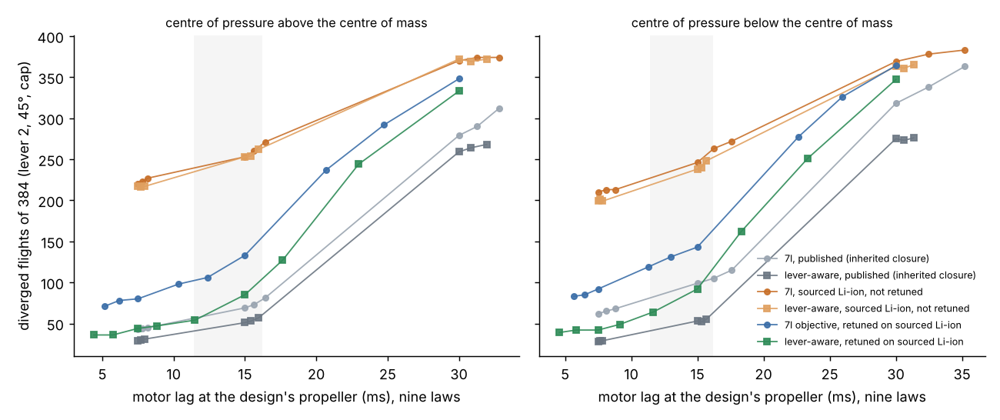

The [rotor-cant programme](../../research/codesign-cant/README.md) co-designs a small quadrotor's frame, propellers and controller in simulation. Each motor and propeller responds to a thrust command with a first-order lag: 15 ms at a 5-inch propeller, scaled as diameter to the power 1.5. That law came with the first milestone and nobody ever sourced it.

This afternoon's run had to look at it. The [previous milestone](2026-11-16-retuned-on-real-batteries-the-quadrotor-gets-heavy-again.md) retuned the designs on sourced battery and motor data, and the tuner shrank the propeller from 0.13 m to about 0.11 m. Under the inherited law, a smaller propeller also means a faster motor: about 12 ms instead of 15.5. If the retuned designs looked good because of that, the result rested on a guess.

## Why a sweep and not a measurement

The plan was to compute the lag from listed motor constants. A motor's small-signal time constant is roughly its rotor inertia divided by its electrical damping plus its aerodynamic damping, and retailers list the KV, the winding resistance and the propeller mass. But the shops' catalogues refused connections from this session, and the bench data we already had stores no KV or resistance. So we did what the [research guidelines](../../research/CLAUDE.md) ask when a number can't be found. We swept it: 7.5, 15 and 30 ms at 5 inches, each with a diameter exponent of 0, 1.5 or 3. That makes nine laws, applied to all 72 designs from the last milestone without retuning. We wrote six predictions into the [log](../../research/codesign-cant/LOG.md) first. All six held.

## What held, and what didn't

| Lever 2, 45° tilt limit (crashes of 384, above / below) | Inherited law | 15 ms for every propeller |
|---|---|---|
| Lever-aware, published | 53 / 52 | 51 / 53 |
| Lever-aware, retuned on sourced Li-ion | 54 / 64 | 85 / 92 |
| Lever-1, published | 73 / 105 | 69 / 99 |
| Lever-1, retuned on sourced Li-ion | 106 / 131 | 133 / 143 |

- **The rankings survive.** Under all nine laws, training across centre-of-pressure levers still beats training at one lever. Up to 15 ms, heavier designs still crash less (rank correlation −0.68 to −0.93).
- **The parity didn't survive.** Under the inherited law the retuned lever-aware designs matched the published ones. When every propeller gets the same 15 ms lag, they crash on 67-74% more flights. Part of the match came from the lag law handing small propellers faster motors.
- **The stability check is tied to the law.** Under the inherited law, all 24 retuned designs pass the programme's linear stability-margin test. With a flat 15 ms lag, only 5 of the 24 pass. Steepen the exponent to 3 and it flips: 8 of the 12 published lever-1 designs fail. The tuner puts every design right at the stability edge for the lag it was trained on.
- **The constant matters most.** At 30 ms, at most one design in 72 passes the margin test under any of the three exponents. With the inherited exponent, every set crashes on 244 to 378 of 384 flights.

## What it means

If you build a drone from a tuned gain set, measure the motor and propeller step response first. Gains tuned for a faster motor than yours can leave you on the edge of stability. For the programme, the qualitative findings now hold across a fourfold range of lag. The crash counts shouldn't be read as numbers until the lag is sourced. The next milestones should source it, or retune with the lag randomised over its plausible range so the stability check covers it.

Everything here is simulated and preliminary: six seeds, one held-out test set, a first-order lag with no ESC current limits, and designs that were not retuned for each law. Code and results: [`experiments/m7s_lag/`](../../research/codesign-cant/experiments/m7s_lag/).
