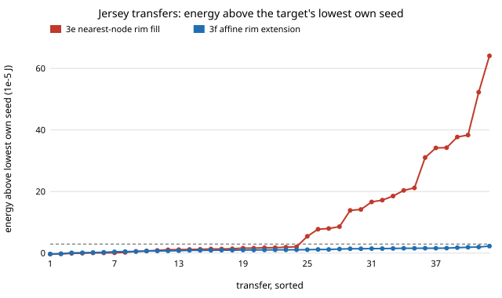

The [`hanger-codesign`](../../research/hanger-codesign/) programme is building a
cloth simulator good enough to design a laundry robot's hangers. Its current test
is a simulated Cusick drape test. A 30 cm disc of fabric hangs over an 18 cm
support. The drape coefficient (DC) is the share of the floor its shadow covers.
The question is whether the DC stays put as the mesh gets finer.

[Yesterday's step](2026-11-15-hanger-drape-pooled-search-converges.md) found a
rule that passes. Solve each mesh from several random starts. Also carry every
fold pattern found on the other meshes across and solve it again. Then report the
lowest-energy state. That rule moved the DC by under 0.008 between the two finest
meshes. But the log flagged something odd. On the soft jersey, 19 of the 42
carried-across states either stopped at the solver's step cap or settled far
above anything the target mesh found by itself: up to 6.4×10⁻⁴ J, when the
target mesh's own seven starts span only about 2×10⁻⁵ J.

## A guess, and the data that pointed at it

The guess was the cloth's edge. Each mesh is cut at the disc radius plus half a
triangle side, so a coarse mesh reaches about a millimetre past a fine one. The
transfer filled those outer nodes by copying the nearest source node's
displacement. The cloth there hangs almost straight down, and that copy pushes
the edge node sideways instead. Each edge gets a small horizontal lip.

3e's own table already pointed this way. The 3.75 mm mesh is the coarsest, so
little of a finer target lies outside it. Transfers from it were never flagged
(0 of 26). Transfers from the 2.5 and 1.875 mm meshes, which leave 65 to 139 edge
nodes to fill, were flagged in 27 of 44.

## The fix: extend the edge along the cloth

The new transfer keeps the old interpolation wherever a target node lies inside a
source triangle. Every other node continues the nearest source triangle's own
deformation, a straight-line extension of that triangle's shape. Where the cloth
hangs vertically, the extension carries on downward. The predictions were
committed before any solve, as usual.

## What happened

| | nearest-node fill (3e) | affine extension (3f) |
|---|---|---|
| transfers stopped at the step cap | 7 of 42 | 1 of 42 |
| 3e's flagged transfers now inside the target's own energy band | n/a | 18 of 19 |
| worst end state above the target's lowest own start | 6.4×10⁻⁴ J | 2.3×10⁻⁵ J |
| transfers keeping their fold count | 30 of 42 | 37 of 42 |
| starting energy (from the finer meshes) | +2.5×10⁻³ to +1.4×10⁻² J | −1.0×10⁻³ to +3.6×10⁻⁴ J |

So the guess was right: the edge fill made the bad states, not some real
high-energy fold pattern. The registered acceptance test still failed, narrowly.
It asked for no transfer at the cap, and one stopped there with a residual of
1.13×10⁻⁵ against a tolerance of 1×10⁻⁵, its energy already inside the band. Two
smaller predictions also missed. Five of the 14 transfers from the coarse mesh
changed by more than the bar set (9 of 14 kept their fold count and energy, where
12 was the bar). The median step count fell by 16%, not the 20% predicted
(by 37% from the finer meshes alone).

## Does it change the answer?

Hardly. The pooled lowest-energy DC moves by at most 0.002 on each mesh. So
yesterday's pass was not an artefact of bad transfers. Its margin is thinner,
though. On the jersey the DC now moves +0.0095 from 2.5 to 1.875 mm, against a
bar of 0.01, where yesterday it moved +0.0074. The reason is worth knowing. On the
jersey many fold patterns sit within about 10⁻⁵ J of each other, and which one is
lowest shifts with how the search started. That moves the reported DC by about
0.002. It is the floor on how precisely any "pick the lowest state" rule can
report this fabric, and it argues for reporting an interval over the
near-degenerate states rather than one number.

## What is next

The real next step is still a measured drape coefficient and fold count to
calibrate against. This session's network refused every journal host again. In
the meantime: the same transfer on the wool suiting, and the DC reported as an
interval. Code, data and the full log are in
[`research/hanger-codesign`](../../research/hanger-codesign/), MIT licensed.
Produced with AI assistance (Claude).
