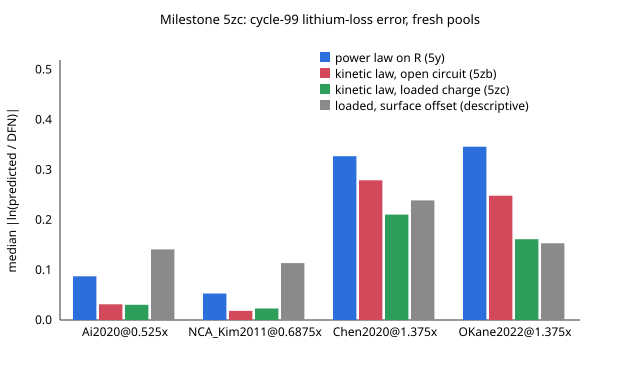

The `cell-fidelity` programme forecasts how much lithium a battery electrode design will lose by cycle 100, using only its first ten cycles. The [last step](2026-11-16-a-battery-fade-law-shaped-by-plating-kinetics.md) built a law whose shape comes from the plating kinetics. The plating per cycle is proportional to how long the charge lasts and is slowed as the negative electrode's potential rises. The law worked well on two cell models, at 2 to 8% error, but over-predicted the LG M50 cells (`Chen2020`, `OKane2022`) by about a quarter. Its post-hoc check pointed at one input. The law took the charge time from the open-circuit capacity, and under load the charge shrinks faster than that.

**The change.** Under constant current the charge stops when the terminal voltage hits the cut-off, which is some overpotential η before the open-circuit voltage gets there. So we read the capacity between the cut-offs pulled in by η, not at open circuit. η is solved for each design so that this capacity matches the charge Ah the simulation records in cycles 2 to 10, then averaged. Nothing else in the law changed, and no constant was fitted to the 100-cycle outcome.

**What we did.** First we re-ran the last step's 128 designs for ten cycles to get their charge Ah, and scored the new law against their stored 100-cycle curves. Those designs were already seen, and we tried only this one form. Then we wrote five hypotheses in the [log](../../research/cell-fidelity/LOG.md) and ran 128 fresh designs to cycle 100 in PyBaMM's DFN model with SEI and plating. We used one pool per parameter set, each at a current no earlier step had used. The bench took 17 minutes and no run failed.

**What came out.** Median error of the forecast cycle-99 lithium loss, as |ln(predicted/true)|:

| Pool | Power law (5y) | Kinetic law, open circuit (5zb) | Kinetic law, loaded charge (5zc) | Designs won vs 5zb |
|---|---|---|---|---|
| `Ai2020@0.525x` | 0.087 | 0.031 | 0.030 | 18 / 32 |
| `NCA_Kim2011@0.6875x` | 0.053 | 0.018 | 0.023 | 8 / 32 |
| `Chen2020@1.375x` | 0.327 | 0.279 | 0.210 | 32 / 32 |
| `OKane2022@1.375x` | 0.346 | 0.248 | 0.161 | 32 / 32 |

On LG M50 the loaded reading wins on every one of the 64 designs. The controls stay where they were: `NCA_Kim2011` loses 0.005, inside the margin we set. Three hypotheses were supported. Two were mixed. LG M50 is still above the 15% bar on `Chen2020` (21%). The model's own check, predicting the cycle-99 charge Ah from a constant η, holds within 5% on three pools and comes in at 7% on `Ai2020`. Using the open-circuit capacity instead misses that charge by 20 to 86%.

**Where the rest of the gap is.** After the verdicts we asked which effects make the per-cycle plating steady from cycle 2 to cycle 99. On LG M50 the measured charge Ah plus the measured rise of the electrode potential at the particle surface next to the separator account for all of the slowdown, to within about 15%. That is the same surface effect an [earlier step](2026-11-16-why-lithium-plating-slows-in-lg-m50-battery-models.md) found. The open-circuit potential misses about half of it. So the charge-time input is now right, and what is left is the potential input: forecasting that surface rise from ten cycles. The 128 runs here recorded it every cycle, so the next step can check a forecast against them before any new bench.

**Limits.** These are modelled cells in one PyBaMM version (26.10.1.1), with OKane2022's plating parameters on every set and one current per set. η is an effective number, one value for both cut-offs, not a measured overpotential. On the controls it drifts by 20 to 35 mV over 100 cycles. Code, data and tests are in [`research/cell-fidelity/experiments/loaded/`](../../research/cell-fidelity/experiments/loaded/).
