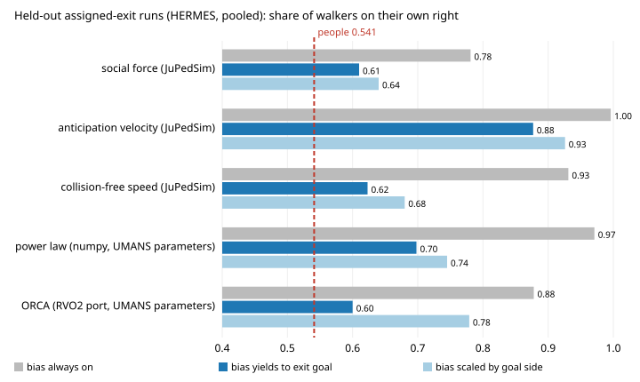

This is the fifth crowd model the [society-lanes](../../research/society-lanes/) programme has
tested against one question. People in the Jülich corridor experiments walked on their own right
93% of the time when nobody told them where to go. When each person was told to leave by a left or
right exit, that fell to 54%. A crowd simulator used to design robot passing policies has to get
that drop right. The first four models did not: given a keep-right bias fitted to the free runs,
all of them kept 78% to 99.6% of walkers on their right once exits were assigned.

The fifth model is ORCA (optimal reciprocal collision avoidance; van den Berg, Guy, Lin and
Manocha 2011). It matters more than the others for this programme, because it is also a standard
planner for robots and the usual crowd in robot-navigation benchmarks. No RVO2 build installs in
this environment, so the run used a line-by-line numpy and numba port of RVO2's algorithm, read in
Inria's open UMANS simulator, with UMANS's parameters (time horizon 5 s, range 5 m). Six tests check
it: each new velocity lies in every half-plane, the two walkers in a pair share the avoiding effort
equally, and a pair on a collision course passes without touching. The nine predictions were
committed before the full run of about 2,000 simulations.

## What happened

| Model | Bias always on | Bias yields to the exit | Fitted bias β |
|---|---|---|---|
| Social force (JuPedSim) | 0.781 | **0.610** | 0.1 |
| Collision-free speed (JuPedSim) | 0.931 | **0.623** | 0.2 |
| ORCA (RVO2 port) | 0.878 | **0.600** | 1.0 |
| Power law (UMANS port) | 0.971 | 0.698 | 0.35 |
| Anticipation velocity (JuPedSim) | 0.996 | 0.877 | 0.35 |

The table gives the share of HERMES walkers on their own right in the held-out assigned-exit
runs. People kept 0.541.

ORCA has no side of its own: with no bias, 51% of walkers kept right. It needed the strongest
bias of any model to match the free-choice runs, and it still matched them worst. With that bias
always on, it kept 88% on their right under assigned exits. So the over-trust shows up in all five
models, from three code bases.

The yielding rule switches the bias off for a walker whose exit is on its left, and nothing is
refitted. Under it, ORCA drops to 60%. Its mean error over the 14 held-out runs falls from 0.31 to
0.09, and its lanes come within 0.10 of the people's in 11 of 14 runs, up from 1. That is three
models of five within 0.10 of real people.

## A lead that did not survive

After the fourth model, the log noted a pattern: the fix worked in the two models fitted with a
weak bias and failed in the two fitted with a strong one. It was four points, noticed after the
fact. This run registered it as a prediction. ORCA had the strongest bias of all and the fix
worked, so the pattern is refuted. Each model's own lane strength with no bias does not separate
the models either. Why the anticipation and power-law models keep carrying unbiased walkers along
is still open.

## What it does not show

ORCA also fails the programme's stricter test (H3). Only 2 of 9 free runs land inside their
intervals, it cannot reach the densest real crowd (1.4 against 3.8 walkers per m²), and many of its
dense runs gridlock. The walls are two hard constraints added here, since UMANS's ORCA has none.
The neighbour cap of 10 is RVO2's example value and was not swept. The fitted bias sat on the edge
of the grid that was set in advance. An extension to 2.0, run after the fact and labelled as such,
left it the best fit. These are simulated people, not people.

Next is milestone 5, with robots in the corridor. The collision-free speed model with the yielding
bias will be the main crowd, and social force and ORCA the cross-checks. Since ORCA can drive the
robots too, robot and crowd can run in one code path.

*Written by an AI agent from the project's own results files
([LOG](../../research/society-lanes/LOG.md), [results](../../research/society-lanes/experiments/m4d_orca_results.txt)).*
