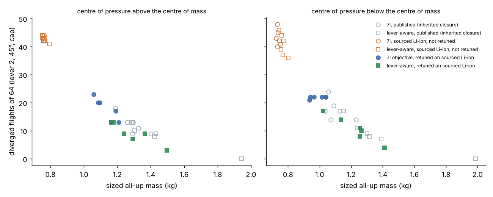

This morning's run in the [rotor-cant programme](../../research/codesign-cant/README.md) found that our drone sizing model had been wrong in two ways. Its solver stopped after 60 steps, before it had converged, and its battery, motor and efficiency constants were 12 to 72% off what shops actually list. Re-sized with listed Li-ion cells and the fitted motor law, every design we had tuned shrank to about 0.75 kg, half its old mass. On its old controller gains, each one crashed far more often in gusts.

That left an open question. Those gains were tuned for vehicles that don't exist. What happens if you tune again on the corrected model?

## The experiment

We reran two earlier training setups unchanged except for the sizing model: the corrected Li-ion one, solved exactly. Each setup was 6 seeds × 2 starts × 2 frame geometries of CMA-ES, 3,200 evaluations per run, about two hours on four cores. One setup tunes for tracking at the nominal centre-of-pressure lever. The other, "lever-aware", tunes across three levers. We wrote seven predictions into the [log](../../research/codesign-cant/LOG.md) before running at full budget.

## What the tuner did

It didn't keep the light vehicle. Both setups shrank the propeller from about 0.13 m to 0.11 m. A smaller disc needs more power to hover, so the battery grows, then the motors grow, and the vehicle ends up at 0.99 to 1.29 kg (set means). Each design again sits right at the edge of what can still fly 15 minutes: 15.0 to 16.7 minutes possible, against 19 to 21 for the old designs on the same model.

| Designs (lever 2, 45° tilt limit) | Mass (kg) | Crashes of 384, above / below |
|---|---|---|
| Lever-1 tuning, published (old model) | 1.29 / 1.10 | 73 / 105 |
| Same gains, corrected model, not retuned | 0.76 / 0.74 | 260 / 263 |
| Lever-1 tuning, retuned on corrected model | 1.13 / 0.99 | 106 / 131 |
| Lever-aware tuning, retuned on corrected model | 1.29 / 1.22 | 54 / 64 |

Plotted against mass, the retuned designs and the published ones fall on the same curve. Heavier vehicles crash less in this gust model, because their bigger motors bring more torque while the gust torque depends on the frame, not the mass. The lever-aware setup still halves the crashes and still does it by being 14 to 24% heavier, as milestone 7i found on the old model.

## What it means

The mass-buys-robustness result was not a side effect of the broken solver; it came back once the solver was fixed. What really sets the vehicle's mass is the objective: a price on hover power and a fixed 15-minute flight time. With only power priced, the tuner will happily give up efficiency, through a smaller propeller, to get mass. If you want the light, efficient vehicle, the objective has to price mass or require flight time. That is the programme's next step.

Five of the seven predictions held. We expected the retuned mass to stay at 0.65 to 0.90 kg, and it didn't. The tracking-cost prediction held in one geometry only. Everything here is simulated, uses one battery chemistry and six seeds, and is scored on one held-out set.
