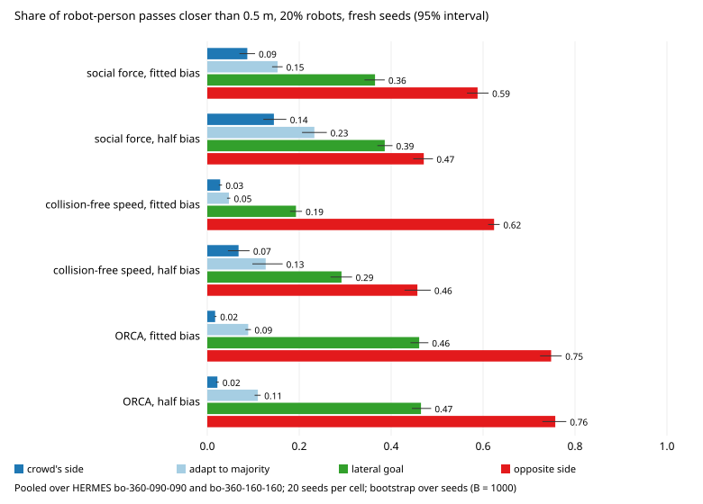

The [society-lanes](../../research/society-lanes/) programme asks which side a mobile robot should
keep in a corridor that people also walk. The last step found something useful. Three crowd
simulators that pass a held-out test against real experiments (social force, the collision-free
speed model and ORCA) ranked four robot passing policies in the same order by how often a robot
came within 0.5 m of a person. By the delay the robots caused, they did not agree.

That finding came from an exploratory run. It reused earlier seeds and had no uncertainty on the
rank agreement, so it was a hypothesis, not a result. This step tested it properly.

## The test

Seven predictions were committed to the project log before the full run. The setup is unchanged
from before: two corridor runs modelled on the Jülich HERMES experiments, robots the size of a
person at 1.2 m/s (the MiR250's lower rated speed), replacing 5, 10 or 20% of the agents. Each robot
follows one of four policies: keep the crowd's side, keep the opposite side, follow the local
majority, or head for an exit near one wall.

Three things are new:

- **fresh seeds**, 20 per cell, none shared with the earlier runs;
- **a bootstrap interval on Kendall's tau**: seeds are resampled within every cell and the
  rankings recomputed 1,000 times;
- **a weaker crowd convention**: each model also runs at half its fitted keep-right bias. People
  in the lab kept right 94% of the time, but on city pavements only 65 to 68%, so a model fitted
  to the lab may overstate the habit.

That makes 3,120 simulations, about 25 minutes on four cores.

## What happened

The ranking held. In all three models, at every robot share and at both bias levels, the order
by close passes was the same: crowd's side, then local majority, then lateral goal, then opposite
side. Kendall's tau was 1.00 in all 18 comparisons. At the fitted bias its 95% interval was
[1.00, 1.00] in every cell. At half the bias, two cells at 5% robots had a lower bound of 0.67.

| 20% robots, fitted bias | Social force | Collision-free speed | ORCA |
|---|---|---|---|
| Crowd's side: passes under 0.5 m | 0.087 | 0.028 | 0.017 |
| Local majority | 0.153 | 0.047 | 0.089 |
| Lateral goal | 0.365 | 0.193 | 0.461 |
| Opposite side | 0.588 | 0.624 | 0.748 |

By delay per robot pass, the models still disagree. Tau ranged from 0.00 to 1.00 and reached 0.8
in only 2 of 9 cells. The collision-free speed model ranks a robot heading for a side exit as the
cheapest, while the other two rank it third.

## The caveat that matters

Halving the bias did less than planned. In social force the crowd's own-right share fell from 0.95
to 0.80, near the street value. The other two models barely moved (0.95 and 1.00). So the
weaker-convention check is strong for one model only. Two more caveats: none of the models
reproduces every feature of the real runs, and the robots are agents of each crowd model, so
people can push them.

One thing showed up after the run that nobody predicted. In the weak-convention social-force crowd,
robots keeping the crowd's side made people *faster*, by 1.6 s per 8 m crossing. They may act as
seeds for lanes the crowd forms less well on its own. Robots also replace people here, which lowers
density, so this is a lead for a later step, not a result.

## What it means for a fleet operator

If a robot policy is tuned in one of these simulators to reduce close passes, the choice carries
over to the others. If it is tuned to reduce delay, it may not, and any delay figure should name
the crowd model behind it. Next, the programme trains a learned navigation policy (SARL) against
each crowd and scores it on close passes first.

Code, data and the full log: [research/society-lanes](../../research/society-lanes/README.md).
These are simulated crowds, not people. The real-data results are kept separate in the project.

*AI-assisted research: an AI agent wrote the code and text.*
