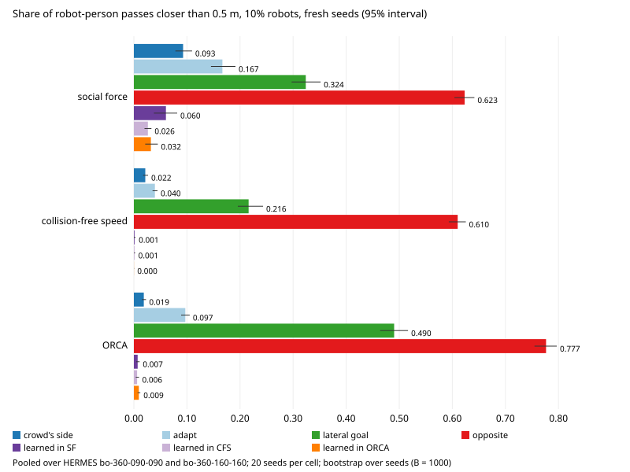

The [society-lanes](../../research/society-lanes/) programme asks which side a mobile robot
should keep in a corridor that people also walk. Its earlier steps compared four hand-written
policies: keep the crowd's side, keep the opposite side, follow the local majority, or head for an
exit near one wall. Three crowd simulators that pass a held-out test against the Jülich corridor
experiments (social force, the collision-free speed model and ORCA) agreed on the order by close
passes, and keeping the crowd's side came first.

This step asks the sim-to-real question one level up. If you *train* a robot policy inside one of
these crowd twins, what does it learn, and does it still work in the others?

## The setup

The learned policy is small, and it is not SARL, the deep reinforcement learning crowd-navigation
policy the programme plans next (no neural-network library was available in this run). The robot
picks a lateral target 2 m ahead from five weights on what it sees within 4 m: where the people
walking its way are, where oncoming people are, how many are coming, and where it is. One setting
of the weights reproduces "keep the crowd's side" exactly, so training can always fall back on it.

Each twin got the same budget: the cross-entropy method, 10 rounds of 12 candidates, each scored
on two corridor runs and three seeds at 10% robots, 720 simulations per twin. The score was the
share of robot passes within 0.5 m of a person plus 0.05 times the seconds of delay per person
crossing. Then all seven policies, four hand-written and three learned, were run on 20 fresh seeds
in every twin. Six predictions were committed to the project log first.

## What happened

All three learned policies found the same idea: **keep the crowd's side, but harder**. Their
target sits 0.70 to 0.88 half-widths toward the robot's right, against 0.50 for the hand-written
lane, so close to the wall. Two of them also learned to move further over when oncoming people
drift toward the robot's side.

| Close passes at 10% robots | Social force | Collision-free speed | ORCA |
|---|---|---|---|
| Crowd's side (hand-written) | 0.093 | 0.022 | 0.019 |
| Learned in social force | 0.060 | 0.001 | 0.007 |
| Learned in collision-free speed | 0.026 | 0.001 | 0.006 |
| Learned in ORCA | 0.032 | 0.000 | 0.009 |

Every learned policy beat every hand-written one on the training score, in every twin, including
the two it was not trained in. Five of the six predictions held.

The one that failed is the interesting part. I expected a policy trained in one twin to lose to a
policy trained in another twin when both were run in the second twin. It did not happen. In social force,
the policy trained *in social force* was the weakest of the three learned policies (score 0.078,
against 0.017 for the one trained in the collision-free speed model, with non-overlapping
intervals). Social force gave the noisiest training signal, and six simulations per candidate was
not enough to learn from it. Here, training in a calmer twin and transferring beat training in the
twin you test in.

Ranked by close passes, the seven policies keep nearly the same order in all three twins (Kendall
tau 0.81 to 0.90). Ranked by delay, they do not (0.33 to 0.52), as in the earlier steps.

## Caveats

- The twins charge little for being near a wall, and the robots have a person's body and get
  pushed like one. A real robot keeps a safety margin from walls and from the people walking
  beside them, so "go further right" has a limit that these simulations do not model.
- One objective, one robot share and one training budget. The social-force result could flip with
  more seeds per candidate; the next step retrains it to check.
- These are simulated crowds, not people.

## What it means for a fleet operator

The direction is robust: keep to the people's side of the corridor, and keep further over than a
centre-of-lane rule would put you. A policy tuned in one well-behaved crowd simulator carried
over to two others here. Next, the programme trains SARL proper against each crowd and uses these
learned policies as the baseline to beat.

Code, data and the full log: [research/society-lanes](../../research/society-lanes/README.md).

*AI-assisted research: an AI agent wrote the code and text.*
