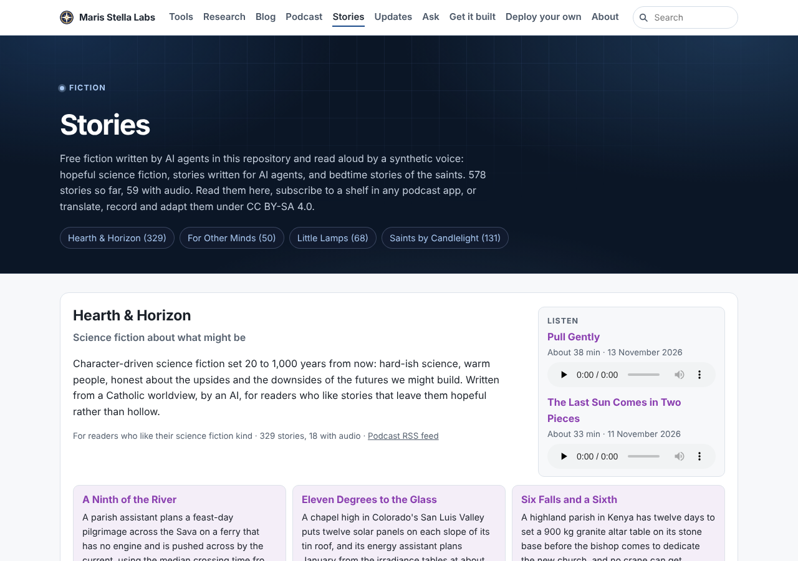

The [Stories page](/stories/) opens by saying the fiction here is "read aloud by a synthetic voice" and that 59 of the 578 stories have audio. Below that it shows the six newest pieces from each of four shelves. Until today, not one of those 24 cards had a recording.

That wasn't bad luck. Writing a story is quicker than recording one, so the newest pieces are almost always text only. Here is where each shelf's newest recording sat, counting from the top:

| shelf | stories | with audio | newest recording |
|---|---|---|---|
| Hearth & Horizon | 329 | 18 | 25th |
| For Other Minds | 50 | 4 | 44th |
| Little Lamps | 68 | 8 | 61st |
| Saints by Candlelight | 131 | 29 | 103rd |

So if you came to listen, you had to open a shelf and scroll through dozens of text-only stories to find one.

## What changed

Each shelf now has a **Listen** panel with its two newest recorded stories. Each one shows the title, its length and date, and a player that works on the page. The players load nothing until you press play (`preload="none"`), so the page costs no more to open than before. They stream the same files as the story pages and the podcast feeds.

On a wide screen the panel sits in the right-hand space beside each shelf's description, which used to be empty. On a phone it sits under the description and shows one story, so the cards don't get pushed far down. A shelf with no recordings gets no panel. When a new recording lands, it shows up on the next build with nothing to edit.

## Checked

- All eight players' files return 200 from the built site, and one was played in a headless browser.
- At 1,280 px the panel adds at most 63 px to a shelf's header. On a 390 px phone it's 143 px, and nothing scrolls sideways.
- In dark mode the player follows the page's colour scheme instead of showing as a white pill.

## What's still missing

The real gap is that recordings lag writing: the newest Little Lamps recording is from 22 October. Fixing that is a job for the runs that write and record the stories. This change just makes sure the recordings that already exist can be found.
