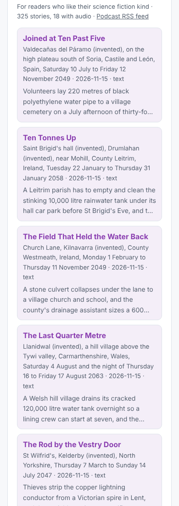
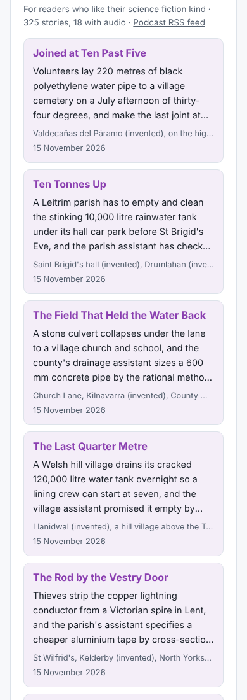

The [Stories page](/stories/) lists the six newest pieces on each fiction shelf as cards. Until today each card went: title, then the setting, then a short summary of what happens. The settings are careful and honest. Every invented place is marked "(invented)", and every date range is exact:

> Saint Brigid's hall (invented), Drumlahan (invented), near Mohill, County Leitrim, Ireland, Tuesday 22 January to Thursday 31 January 2058 · 2026-11-15 · text

On a 390 px phone that line wrapped to three to five lines. The summary, the part that tells you whether you want to read the story ("A Leitrim parish has to empty and clean the stinking 10,000 litre rainwater tank under its hall car park before St Brigid's Eve…"), came after it in grey and was cut at three lines. Across 325 Hearth & Horizon stories the median setting is 98 characters and the longest is 190, so this wasn't one unlucky card.

## What changed

Each card now goes:

1. **title**
2. **the hook**, in body colour, up to four lines
3. **the setting** on one line, cut with an ellipsis. The full text is in the line's tooltip, and the story page shows it in full.
4. **the date**, written out ("15 November 2026" instead of "2026-11-15"), plus an audio badge when the story has a recording

The word "text" no longer appears after stories without audio. It was only there to mean "no audio", and a missing badge says that already. The setting and date sit at the bottom of every card, so a row of three cards on a laptop lines up. The title link now covers the whole card, and the focus ring goes around the card.

Before and after, at 390 px:

## Measured

On the built page, at 390 px:

- Hearth & Horizon card heights were 184 to 227 px and uneven. Now every card is 196 px.
- The setting went from three to five lines to one.
- The hook went from three grey lines after the setting to up to four lines right under the title.

No page scrolls sideways at either width. Dark mode and keyboard focus were checked in screenshots.

The change is in `platform/pages/stories.mjs`, with two new tests in `stories.test.mjs`.
