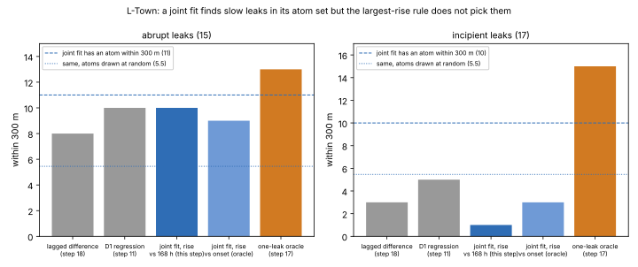

The [water-leaks](../../research/water-leaks/README.md) programme asks how well
leak detection and localisation work on BattLeDIM's L-Town, the one public
benchmark with a realistic water network, two years of sensor data and a
published leak schedule. L-Town is a simulated network with simulated leaks.
Nothing here is a field result.

Two days of work have narrowed the localisation question down. With every
other leak removed from the pressure signal (an oracle, since it uses the leak
list), the network model places 28 of 32 leaks within BattLeDIM's 300 m. A
residual a utility could compute, the change against the same hours a week
earlier, places 12. The leak flows explained the gap. In 2019 about twenty leaks
overlap, and inside any window the other leaks change about as much as one slow
leak grows.

## What we tried

Step 19 stopped differencing the other leaks away and modelled them. The leaks'
pressure effect at the 33 sensors is fitted as a non-negative sum of leak
signatures at the network's 782 junctions. Greedy pursuit adds the junction
that best explains what is left, refits every flow, and stops when an addition
gains under 5%. The fit runs a week before the leak, then again at the leak,
starting from the same junctions. The leak is placed where the fitted flow rose
most. The plan and five predictions went into the
[log](../../research/water-leaks/LOG.md) before anything was computed.

## What happened

- **11 of 32 within 300 m, slow leaks 1 of 17.** That is the same as the week-old
  difference (11, paired 4 against 4) and below the regression residual (15).
  Four of the five predictions failed.
- **The fit is good.** A median 10 junctions leave 4.6% of the signal
  unexplained, and the fit has a junction near 59% of the leaks running at the time.
- **Seen after the run:** the fit has a junction within 300 m of **10 of the 17
  slow leaks**, against 5.5 expected if as many junctions were drawn at random
  (P = 0.016). The largest-rise rule picks only 1 of those 10.

## Why it matters

A slow leak is already in last week's fit and grows only a little within a week.
The largest one-week rise goes to whichever junction absorbs the other leaks'
changes. On L-Town, finding the slow leak is not the hard part. The hard part is
telling which of the fitted sources is new. That points the next step at
tracking each fitted source through time and dating a leak by when its flow
starts rising, instead of comparing two windows.

The post-hoc split has no verdict: we found it after the run and added its
chance level then. Code, results and the per-leak table are in
[`experiments/step19-joint/`](../../research/water-leaks/experiments/step19-joint/results.txt).
AI-assisted research; no affiliation with the BattLeDIM organisers is implied.
