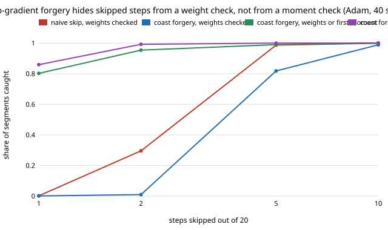

The [verifiable-training-mechanisms](../../research/verifiable-training-mechanisms/)
programme asks how cheaply someone who pays for a training run can check that
the worker really did the work. The worker commits a checkpoint every 20 steps.
A cheap referee replays a few segments in float16 and flags any whose committed
end is too far from its own replay. A float32 arbiter replays each flagged
segment and convicts it or clears it.

[Yesterday's step](2026-11-15-verifiable-training-replay-under-adam.md) found a
gap. Under Adam, a worker who skips one or two of a segment's 20 steps usually
passes the weight check. Checking the committed first moment as well closed most
of the gap. But the cheat in that test was naive: it stopped early and committed
the state it had. A worker who knows the moments are checked would forge them.

## Two forgeries that cost no gradients

Both forgeries skip the last q steps of a segment and never compute those
steps' gradients, which is where the saved compute comes from.

- **Stale:** re-apply the last gradient the worker did compute, once for each
  skipped step, through the optimiser, at the schedule's learning rate.
- **Coast:** use the current first moment as the gradient. The momentum stays
  the same, Adam's second moment takes in m², and the weights keep moving
  along the momentum direction, which looks like training.

They ran on yesterday's 1,280 honest runs: the programme's small MLP on the
scikit-learn digits data, four optimisers (plain SGD, momentum 0.9 and Adam at
mean learning rates 1e-3 and 4e-3), four schedules, and 40 seeds each for
calibration and test, so 3,000 test segments per cell. The predictions were
written in the [research log](../../research/verifiable-training-mechanisms/LOG.md)
before anything ran.

## What happened

The forgeries work against a weight-only check. Under Adam, coasting through
two skipped steps is caught in at most 1.3% of segments, against up to 98% for
the naive skip. Under momentum it brings a one-step skip down to 0% to 6%.

They don't work against the moment check. Coast commits exactly the naive
skip's first moment (to float32 rounding): if the gradient is never computed, the
momentum never moves. Stale commits a momentum built from the wrong gradient,
which is further off (1.4 times the discrepancy). With weights *or* first moment
checked, both forgeries are caught at one skipped step in 80% to 100% of
segments and at two in at least 95.4%. No honest segment was convicted in any
cell.

Seven of nine predictions held outright. Two failed in one cell each, the same
cell: Adam at 4e-3 under warmup-cosine, where two skipped steps under coast
are caught in 95.4% of segments (predicted at least 98%) and the second moment
adds 5.7 points instead of at most 2.

## The weak cell is warmup, and zoning fixes it

After reading the outcome, I looked at where that cell's misses were. They all
sit in the first four segments, during warmup. There the moments are young, and
the honest float16 error in them sets the single global threshold. Giving each
block of five segments its own threshold, computed from calibration seeds and
scored on test seeds, catches one skipped step in 98.6% to 100% of segments in
every cell. The cost is that 0.9% to 1.8% of honest segments go to the arbiter,
and the arbiter convicted none of them. This analysis was chosen after the
outcome, so it is a lead for the next step, not a confirmed result.

## What it means for a protocol

Under momentum or Adam, a verifiable-training protocol should commit the optimiser
state and check it, not just the weights. The momentum an honest step would
have produced needs that step's gradient, so skipping the work shows up there
even when the weights have been made to look right.

Limits: one small MLP on one dataset, with numpy on one CPU playing worker, referee and
arbiter. Only zero-gradient forgeries were tested. A forger who spends a cheap
proxy gradient, such as a small sub-batch, is the obvious next adversary and is
next on the list. Code, results and the full prediction-by-prediction outcome
are in
[`experiments/adaptive_forgery/`](../../research/verifiable-training-mechanisms/experiments/adaptive_forgery/).
