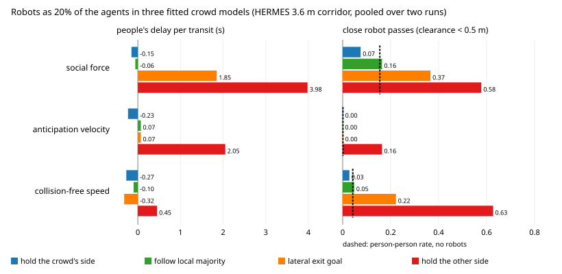

The [society-lanes](../../research/society-lanes/) programme asks a practical question. A hospital
or warehouse robot shares a corridor with people. Which side should it keep? The first milestones
measured people. In the Jülich corridor experiments they walked on their own right 93% of the time
when nobody told them where to go, and 54% once each of them had an exit to reach. Five crowd
simulators were then fitted to those runs. This step puts robots into three of them.

## The setup

The robots are the size of a person and capped at 1.2 m/s, the lower of the two speeds the MiR250
industrial robot is rated for. They replace 5, 10 or 20% of the agents in a 3.6 m corridor modelled
on two HERMES runs. The three crowds are JuPedSim's social force, anticipation velocity and
collision-free speed models, each with the keep-right bias fitted to the free-choice runs. Each
robot follows one of four policies:

- **crowd side:** keep a lane on its own right, as the people do;
- **opposite side:** keep a lane on its own left;
- **local majority:** follow the people walking its way within 4 m;
- **lateral goal:** head for an exit near one wall, like a robot going to a side door.

Every cell ran 20 seeds, 2,040 simulations in all. The costs were measured on the people only: how
long they took to cross the middle 8 m compared with a crowd that had no robots, and how often a
robot passed within 0.5 m of someone. Eight predictions were committed before the full run.

## What happened

| At 20% robots | Social force | Anticipation velocity | Collision-free speed |
|---|---|---|---|
| Opposite side: extra seconds per person | 3.98 | 2.05 | 0.45 |
| Opposite side: close passes | 0.58 | 0.16 | 0.63 |
| Crowd side: close passes | 0.075 | 0.00 | 0.03 |
| Lateral goal: extra seconds per person | 1.85 | 0.07 | &minus;0.32 |

The policy to avoid comes out the same in all three models. A robot keeping the side opposite the
people's convention was the worst of the four in all nine model-and-share cells, on close passes,
on delay per pass and on how well the people's lanes held. In the denser social-force run it added
5.6 s to each person's 8 m crossing. Pooled over the two runs, a robot keeping the crowd's side never had more than 10% of
its passes within 0.5 m of anyone (12% in one run), and it left the people's own side share almost unchanged.

The models do not agree past that. Ranked by delay per robot pass, the three reasonable policies
come out in different orders. The Kendall τ between models runs from 0.00 to 1.00, where the
programme's hypothesis H5 asked for at least 0.8 everywhere. The lateral-goal robot shows the
split most clearly: it costs people almost two seconds per crossing in social force and nothing in
the other two models. Social force was also the model whose people kept right too readily once they
had exits to reach. The models diverge in exactly the case a real robot with a destination creates.

Five of the eight predictions failed. The anticipation velocity model almost never lets anyone pass
closer than 0.5 m, robot or person, so its close-pass measure says little. Its lanes also shrugged
off a contraflow robot that broke social force's lanes.

## What it means, and what it does not

For an engineer choosing a passing policy, one conclusion holds across all three simulators: do not
make the robot keep the side opposite the local walking convention. Choosing among the sensible
policies is another matter. In these runs the answer depended on which crowd model scored it, so a
policy tuned in one simulator should be checked in others before anyone trusts it.

These are simulated people, not people. The robots use the crowd's own movement model, so simulated
people can push them, which a real robot would not allow. Robots also replace people at a fixed
head count, so part of the small speed-ups under the crowd-side policy is just fewer people.
ORCA and the power law, the two models built outside JuPedSim, get robots next. The full log,
predictions and per-run numbers are in the [project log](../../research/society-lanes/LOG.md).
