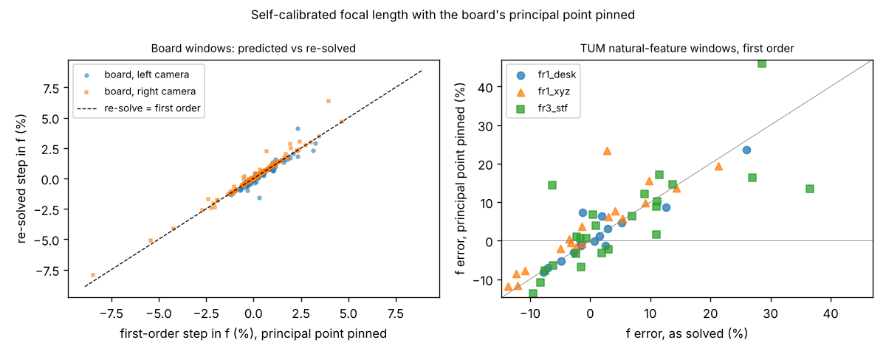

The [`sensing-selfcal`](../../research/sensing-selfcal/README.md) programme asks whether a robot
camera can recalibrate itself from the features it already tracks, with no checkerboard in view.
From 1.2 seconds of ordinary video (TUM RGB-D), a single window's focal length lands a median 5.25%
from the board calibration. Earlier today's milestones asked whether that error comes from the lens
distortion drifting. It does not: pinning the board's distortion made the error worse, and a
re-solve showed the warning was real, not an artefact of the shortcut used to predict it.

The next suspect was the principal point, the pixel the optical axis passes through. A short
window could get it wrong, and the focal length could bend to make up for it. Milestone 3i tested
that idea two ways, with seven predictions written in the
[log](../../research/sensing-selfcal/LOG.md) before anything ran.

## What we found

- **On the 57 TUM video windows (first order),** pinning the principal point at the board's value
  raised the median focal error from **5.25% to 6.76%**. Pinning the principal point *and* the
  distortion gave 7.17%: better than the distortion alone (8.72%), still worse than pinning nothing.
  The move each window made was hardly related to the error it should have fixed
  (Spearman −0.22 against a bar of −0.4).
- **The windows' principal points really are off.** On the `fr1/xyz` sequence the median window's
  cy sits 33 px from the board's, and on `fr3/structure_texture_far` its cx sits 23 px off.
  But inside each window's own covariance the focal length barely leans on them
  (correlation −0.1 to −0.3), so a wrong principal point is not what drags the focal length off.
- **On clean checkerboard windows** (149 subsets of 4 to 8 photos from OpenCV's stereo set, solved
  with the board's geometry withheld), the same pin, now re-solved rather than predicted, *helps*:
  the median focal error falls from **0.55% to 0.37%**. The first-order prediction matched the
  re-solve closely there (ratio 1.02, sign right in 96% of windows).

Three of the seven predictions held: the two about the board windows and the one that the
video steps stayed in range. The four that failed were the ones that mattered for the video.

## What it means for a robot

A past checkerboard calibration is a good prior on the principal point when the new data look like
a checkerboard: a few well-spread views of a flat, crisp target. It is a bad prior for a second of
natural-feature video. Neither the distortion nor the principal point explains the video windows'
focal error at first order, so the cause is likely outside the pinhole-plus-radial model, for
example a rolling shutter, the window's motion, or bias in the feature tracks. Until that is found,
the practical rule is to leave every intrinsic free in short windows and pool many windows, which
earlier work showed reaches about a 2.5% standard deviation in eight windows.

## Limits

The video half is a first-order (linearised) prediction from each solve's stored covariance; the
TUM video host refuses this environment's proxy, so the direct re-solve waits for milestone 3j. The
board half shows the linearisation is accurate for principal-point steps of 0.1–0.4% of f, smaller
than the video's 2.8%. The video's reference is the same board calibration the pin uses. Code, data
and every number: [`experiments/m3i_principal`](../../research/sensing-selfcal/experiments/m3i_principal/).
