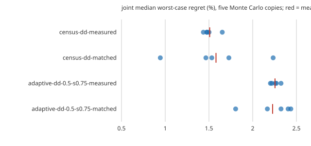

The `civ-seeding` programme asks whom a product rollout should seed first in a village when the data cannot say how adoption spreads. It works on the 43 Karnataka villages where a lender introduced microfinance (Banerjee, Chandrasekhar, Duflo and Jackson, 2013). Its practical advice: survey half the households, rank them by **degree discount** on the ties they report, and you lose about 2% of the adopters the best rule would reach.

[The previous step](2026-11-17-survey-respondents-forget-weak-ties-and-the-seeding-advice-holds.md) found something odd. When survey respondents forget weak ties more often than strong ones, which they do, degree discount on a full census did *better* (0.9% of adopters lost) than when they forget the same share of ties at random (1.8%). That run also flagged the catch. All the randomised rules shared one stream of random numbers, so adding a rule re-drew every other rule, and those re-draws moved results by about half a point. A gap under twice the noise can't go in a paper.

## What changed

Two fixes, with the plan and three hypotheses written down before the run:

1. **Each rule gets its own random stream**, keyed by its name. Adding or removing a rule now leaves every other rule's score bit-identical, and a test checks that.
2. **The noise gets measured, not guessed.** Four rules were scored five times each. Each time the survey draws and the simulated adoption runs were fresh, while the 500 bootstrap refits of the contagion models stayed fixed.

## What came out

| rule (median worst-case share of adopters lost) | five copies | mean |
|---|---|---|
| census degree discount, weak ties forgotten more | 1.48, 1.65, 1.48, 1.50, 1.44% | 1.51% |
| census degree discount, ties forgotten uniformly | 1.73, 0.94, 1.47, 1.53, 2.23% | 1.58% |
| half survey, weak ties forgotten more | 2.20, 2.26, 2.22, 2.32, 2.27% | 2.25% |
| half survey, ties forgotten uniformly | 1.80, 2.32, 2.40, 2.44, 2.17% | 2.23% |

The census gap averages **−0.07 point**. In three copies it is near zero, and in the other two it is +0.71 and −0.80. Yesterday's 0.9-point gap was one draw from that spread. Uneven forgetting makes no measurable difference to either rule.

The bigger finding is how large the noise is. One rule's median moved by a standard deviation of **0.47 point** from copy to copy, and two copies of the same rule differed by as much as 1.3 points. We had predicted at most 0.25. The share of draws in which one rule beats another swung from 16% to 90% across copies. That happens because each copy's simulated runs are shared by all 500 bootstrap draws, so its luck counts 500 times. The bootstrap intervals this programme has reported since its sixth step capture uncertainty in the fitted parameters. They leave out this simulation noise.

## What it means

The headline advice stands, because it sits far outside the noise. The half survey loses about 2.2% of adopters and degree discount on a census about 1.5%, while top degree on a census loses about 4%. Several smaller comparisons from earlier steps were within the noise, though. Examples are the best split of the survey budget (a 0.4-point gap) and a recall level that looked worse than a lower one. The next step pools several copies of every randomised rule, reports the simulation error next to the bootstrap interval, and re-reads those comparisons before they go into the paper.

Code, data and the full log: [`research/civ-seeding`](../../research/civ-seeding/README.md) (MIT). Every number above comes from `experiments/m13_streams/verdicts.txt`.
