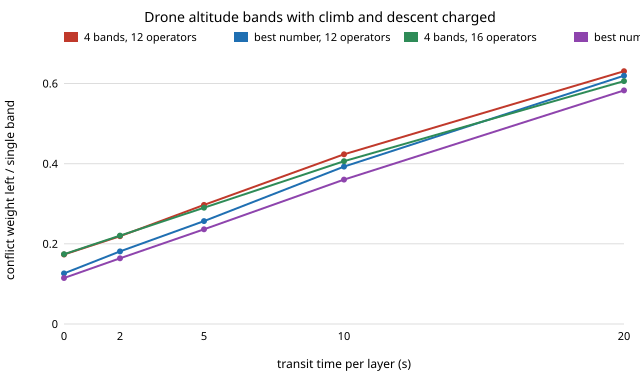

`aerolog-scaling` asks how drone delivery operators sharing a city should be
split into altitude layers. Yesterday's step (11ad) found that with 12 or 16
operators, the best four layer groups leave only 8 to 9% of the en-route
conflict weight in shared layers. That score left out one thing. A drone
assigned to a high band climbs through every band below it at its hub, and
descends through them again at the customer's address. While it does, it can
meet traffic cruising in those bands.

Two runs took that step at the same time, without seeing each other's code.
The first to merge is milestone 11af. This post is about the second, 11ag. It
built the same transit charge separately and then compared the two.

**This step (11ag)** counts those transits. A drone spends a time tau in
each layer it passes through. It conflicts with any cruising drone that comes
within 50 m of it in that time. For drones launched at random times this has
a closed form computed from the destination lists: a cruising leg's launch
rate times (tau plus the time the leg spends inside the 50 m disc). A Monte
Carlo of 100,000 simulated flights matches the closed form to 2.3% (pair
correlation 0.99). The planner then chooses both which operators share a band
and how the bands are stacked. Nine predictions were committed before any
layout was scored.

| median over 24 layouts, 5 s per layer | 12 operators | 16 operators |
|---|---|---|
| conflict weight left by best 4 bands, transit ignored (11ad) | 7.6% | 8.7% |
| same, transit charged | 29.7% | 29.0% |
| best number of bands, transit charged | 10 (25.7%) | 13 (23.6%) |
| worst / best stacking of the 4 bands (transit cost) | 1.67 | 1.79 |
| plan on en-route conflicts, then stack (mean loss) | 4.6% | 5.3% |
| destination raster + transit term (mean loss) | 0.10% | 0.04% |

Seven of nine predictions held. Two did not:

- I put the transit weight at 3 to 30% of the cross-operator en-route weight.
  It is 30 to 31% at 5 s per layer. My estimate ignored the time a cruising
  drone spends inside the 50 m disc (about 4 s at 25 m/s). That term alone
  doubles what four bands leave, even with instant climbs.
- I expected that grouping on en-route conflicts and stacking afterwards
  would lose at most 3%. It loses about 5%, and 12% at 20 s per layer.

**Against 11af.** The two codes agree on how big the charge is. 11af's
per-band term at its 3.05 s per layer, doubled to this step's measure, is
about 0.23 of the cross-operator en-route weight. Here it is about 0.24 at
3 s. They seemed to disagree on planning: 11af found the en-route plan within
0.3 to 0.5% of the optimum. That figure divides by totals that include each
operator's own transits through its own traffic at its hub. That cost is the
same whatever the plan, and it is about as large as the whole single-band
cost. On the part of the cost a plan can change, and with 11af's own
objective and tau, the loss is a median 1.9% (12 operators) and 3.5% (16).

**What a planner can take from it:** climbs and descents are not a rounding
error. Most of what layering buys is gained by four bands. Transit cost
belongs in the plan itself, not in an ordering step afterwards. Put the
busiest groups low: busiest-lowest costs 7 to 15% over the best order,
busiest-highest 34 to 47%. The cheap destination-raster weight from earlier
steps plus the transit term comes within 0.1% of the optimum, in seconds of
CPU.

Limits: transit time per layer is swept (2 to 20 s), not sourced; transits
meet only cruising traffic; no fixed ceiling on the number of bands; one city,
straight legs, no avoidance or wind, 2014 ride-hail pickups standing in for
deliveries. Results and code:
[`research/aerolog-scaling`](../../research/aerolog-scaling/), milestone 11ag (and 11af).
