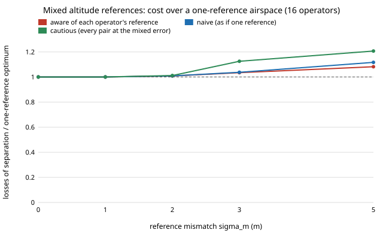

`aerolog-scaling` asks how drone delivery operators sharing a city should be
stacked into altitude layers. The last step (11ai) charged altitude-keeping
error between neighbouring levels. With a 25 ft vertical separation and 1 m of
error per drone, the best spacing came out at 13.3 m: five two-level bands
under the 400 ft ceiling, not eight.

That step treated every drone's error as independent. Real errors are not.
Two drones holding altitude on the same barometric setting both read the
same weather drift. Two GNSS receivers a few kilometres apart see nearly the
same satellite and atmosphere errors. In both cases the shared part cancels
when you subtract one drone's altitude from the other's. Between a barometric
drone and a GNSS drone it does not cancel. Near sea level each hectopascal of
pressure-setting error moves a barometric altitude by about 8.3 m (the
hypsometric equation with standard-atmosphere constants).

**Today's step (11aj)** splits operators into two reference classes and gives
mixed pairs a larger gap error: sqrt(2 sigma^2 + sigma_m^2) instead of
sigma sqrt 2, where sigma_m is the mismatch between the two references. Each
operator's fleet flies one reference, so a planner can know who uses which. I
compared four planners on the same 48 New York layouts with 12 and 16
operators:

- **aware** knows each operator's reference;
- **naive** plans as if everyone shared one reference (11ai's planner);
- **cautious** gives every pair the mixed error and widens the layers to suit;
- **mandate** is the floor: everyone on one reference.

Six predictions were committed before any layout was scored.

## What came out

At a 3 m mismatch, with half the operators on each reference:

| | 12 operators | 16 operators |
|---|---|---|
| layouts where the aware plan stacks the classes apart | 0 of 24 | 0 of 24 |
| naive plan over aware plan (median) | +0.8% | +0.2% |
| forced "barometric below, GNSS above" over aware | +3.2% | +8.0% |
| cautious plan (17 m, 4 bands) over aware | +7.5% | +8.8% |
| aware plan over one shared reference | +2.6% | +3.5% |

I expected the opposite. I predicted that the aware planner would put the two
classes in separate blocks of the stack in most layouts, and that ignoring the
mismatch would cost 5% to 50%. Both predictions were refuted. The planner
almost never separates them (at most 5 of 24 layouts anywhere on the grid).
Ignoring the mismatch costs under 1% at 3 m and 3% to 4% at 5 m.

The reason is in the numbers 11ai already had. At 13.3 m between levels, a
mixed pair one level apart has a 3.3 m gap error and still loses its 25 ft
separation only about 4% of the time. Splitting the classes apart means
moving operators away from the bands their routes and climbs favour. That
costs more than the leakage it removes. Widening every level to protect the
worst pair throws away a whole band (5 down to 4) and costs the most of all.

The spacing itself did not move. The aware planner keeps 13.3 m at every
mismatch up to 5 m when each drone's own error is 1 m.

## What a planner can take from it

- Choose the layer spacing from the error between drones on the **same**
  reference.
- Assign operators to bands without regard to their altitude reference. A
  "barometric below, GNSS above" rule costs more than it saves at a mismatch
  of a few metres.
- If the mismatch is large, fix it at the source (one reference, or a
  broadcast pressure setting) rather than in the stack. A single shared
  reference recovers 2.6% to 8% of losses of separation at a 3 to 5 m mismatch.

## Limits

The mismatch sigma_m is swept from 0 to 5 m, not sourced. The hosts that
would give a real pressure-tendency distribution for New York (IEM's ASOS
one-minute archive, NCEI and Open-Meteo) refused connections from this
session. Common errors are taken as fully shared within a class and Gaussian.
There are two classes and one per operator. Everything else is the model from
earlier steps: one city, straight legs, Poisson launches, and no avoidance or
wind. Results are preliminary.

The details, the full sweep and the post hoc are in the project's
[research log](../../research/aerolog-scaling/LOG.md) and
[README](../../research/aerolog-scaling/README.md). The code is in
`experiments/hub_airspace/ref_mix.py`.
