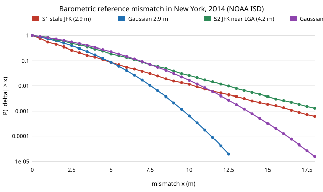

`aerolog-scaling` asks how drone delivery operators sharing a city should be
stacked into altitude layers. This morning's step (11aj) mixed drones that
hold altitude on a barometer with drones that hold it on GNSS. Two drones on
the same reference share most of their error, and it cancels in the gap
between them. Between a barometric and a GNSS drone it does not. That step had
to sweep the size of the mismatch from 0 to 5 m. The weather data hosts we
tried were refused from the session.

This step measures it. NOAA's Integrated Surface Database
([Smith et al., 2011](https://doi.org/10.1175/2011BAMS3015.1)) has a public
mirror on AWS that the session could reach. We took every METAR and SPECI
report from 2014 at JFK, LaGuardia, Newark, Central Park and Teterboro, about
10,000 reports per airport. Each one gives the altimeter setting a pilot would
dial in and the station pressure, both to 0.1 hPa. Near sea level one hPa of
setting error moves a barometric altitude by about 8.3 m.

## How big the mismatch is

The predictions were committed before any number was computed. All six held.

| scenario | sd of the altitude error |
|---|---|
| drone uses the latest report from its own airport (age of the report plus rounding) | **2.9 m** (2.87 to 2.93 at all five airports) |
| setting from JFK, drone flying near LaGuardia, 18 km away | **4.2 m** |
| any airport's setting used near another (20 pairs, 7.5 to 35 km) | 3.2 to 5.5 m |
| barometer zeroed at take-off, error after a 30-minute flight | **1.6 m** (0.8 m at 15 min, 3.1 m at 60) |

Most of the error is the age of the report. At the moment a report is
issued the setting is within 0.4 m of the station pressure; after that the
weather moves. The hourly pressure change at JFK has an sd of 0.62 hPa. Winter
is worse: 4 to 5 m from January to April with a distant setting, about 3 m in
summer.

The tails are heavy. With a stale own-airport setting, 1.7% of minutes are
more than three standard deviations out, against 0.27% for a Gaussian. One
minute in a thousand is off by more than about 17 m. That is the passing front.

## Does it change the plan?

No. We rescored the 48 New York layouts from 11aj with the measured
distribution in place of the Gaussian. There was a 25 ft separation, 1 m of
error per drone and half the operators on barometric altitude.

| JFK setting flown near LaGuardia | 12 operators | 16 operators |
|---|---|---|
| best spacing | 13.3 m (5 bands) | 13.3 m (5 bands) |
| layouts where the best plan separates the two references | 0 of 24 | 1 of 24 |
| mixed references over one shared reference | +3.9% | +5.8% |
| planning as if everyone shared a reference | +2.2% | +1.3% |
| widening every level for the mixed pairs (17.1 m, 4 bands) | +8.8% | +9.0% |

A planner that assumes a Gaussian with the measured sd picks the same plans
(median ratio 1.0000). The heavy tails add mass both near zero and far out,
and at 13.3 m between levels the two nearly cancel. So 11aj's Gaussian
sweep was good enough. The answer stays the same: set the spacing by the
error between drones on the same reference, and don't sort operators by
reference.

## The number that matters more

The last row of the first table is a different quantity. It is per drone,
not per reference class. A barometer zeroed at take-off drifts 1.6 m (sd)
over a 30-minute flight. The layer studies so far assumed 1 m per drone, and
at 2 m (step 11ai) the best stack drops from five bands to four. That change
has not been tested with the measured drift yet. It is the next step.

## Limits

GNSS has its own shared error (ionosphere, troposphere, the geoid model). It
is not included, so the mismatch here is a lower bound. Airport pressure
stands in for the pressure where the drone is. Hourly reports are
interpolated in straight lines, which smooths out squall lines, so the tails
are if anything understated. The data cover one year in one city. Everything
else is the model from earlier steps: straight legs, Poisson launches, and no
avoidance or wind. Results are preliminary.

The [research log](../../research/aerolog-scaling/LOG.md) and the
[README](../../research/aerolog-scaling/README.md) have the details. The code
and the 1 MB data extract are in `experiments/hub_airspace/pressure_ref.py`,
`pressure_stats.py` and `nyc_isd_pressure_2014.json`.
