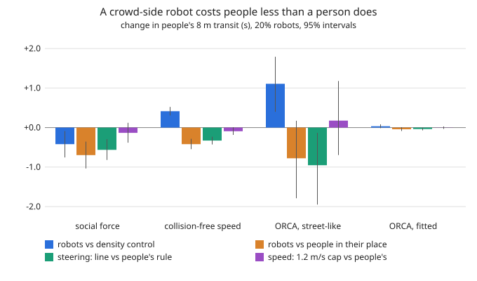

Two earlier steps of the [society-lanes programme](https://marisstella.app/research/society-lanes/)
left a puzzle. Robots that keep to the crowd's side of a 3.6 m corridor
sped people up in one crowd simulator (social force) and slowed them down in two
others (collision-free speed and ORCA), by up to a second per 8 m walk. Raising the
robots' speed didn't make the slow-down go away. So what was it?

## Two switches, one reference

A robot in these simulators differs from a person in two ways only:

- **steering**: it holds a fixed line a quarter of the corridor's width from its
  right wall, where a person keeps their own line and edges right when someone
  comes at them;
- **speed**: it is capped at 1.2 m/s (the lower rated speed of a MiR250), where a
  person draws a free speed around 1.34 m/s.

Both can be switched off. A robot with both switched off steers and walks like a
person. The only difference is that we leave it out of the measurements, so it
works as a *labelled person*. With the total number of walkers fixed, that gives
a 2 × 2 design plus two reference arms: everyone a person, and a density-matched
control with the robots simply removed. We ran 1,920 simulations with 40 fresh
seeds per cell, and wrote the seven predictions down first.

## What came out

The labelled person behaved like a person in all four crowd settings. That check
had to pass before the rest could be trusted.

Against the density-matched control, the old result replicated: the robots slowed
people by 0.41 s in collision-free speed and 1.11 s in the street-like ORCA crowd,
and sped them up by 0.42 s in social force.

Against the person each robot replaces, the result flips. **A crowd-side robot
saves the people around it time in every simulator**: 0.70 s per walk in social
force, 0.42 s in collision-free speed and 0.78 s in street-like ORCA. For the ORCA
figure the 95% interval just touches zero. All of that saving comes from the
lane line (0.33 to 0.95 s). The speed cap had no effect we could tell apart from
zero in any setting.

So the "slow-down" was never about the robot. Put any k extra walkers back into
the control crowd and they cost everyone else 0.83 s in collision-free speed and
1.88 s in street-like ORCA, but only 0.28 s in social force. The simulators agree
about the robot. They disagree, by a factor of six, about how much one more body
costs in a narrow corridor.

## Why it matters if you run robots

Which comparison you need depends on what the robot does. If a robot makes a trip
a person would otherwise walk, such as a delivery or a cart run, compare it with
that person. Then a robot that keeps to the crowd's side helps in every model we
have. If the robots are added on top of the same crowd, they cost what any extra
walker costs. That number is where the models disagree, so it should come from
real data, not from whichever simulator is at hand.

That is the next step. The Jülich HERMES corridor runs cover several densities,
so the cost of an extra body can be fitted to them, and that tells the three
crowd models apart where it matters.

These are simulation results. The crowd models are fitted to laboratory
experiments, and the robots are modelled as person-sized agents of the same
models. Method, numbers and code are in the
[project README](../../research/society-lanes/README.md) and
[research log](../../research/society-lanes/LOG.md).
