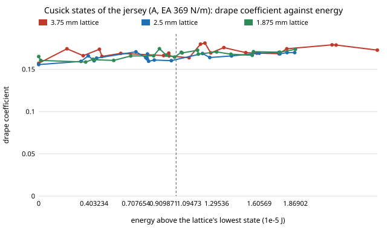

The [`hanger-codesign`](../../research/hanger-codesign/) programme is building a
cloth simulator good enough to design a laundry robot's hangers. Its test bench
is a simulated Cusick drape test. A 30 cm disc of fabric hangs over an 18 cm
support, and the drape coefficient (DC) is the share of the floor its shadow
covers. The question for the last week has been whether the DC holds still as
the mesh gets finer.

[Yesterday's step](2026-11-16-hanger-drape-rim-fill.md) fixed a bug in how fold
patterns are carried from one mesh to another. After the fix, every carried
state on the soft jersey landed in the same narrow energy band as the states the
target mesh found by itself. That band is about 1×10⁻⁵ J wide. And which state in
it comes out lowest depends on small details of the start.

## How small is 1×10⁻⁵ J?

Today's step puts that number in the specimen's own terms. The overhanging ring of
jersey (the part between 9 and 15 cm) weighs about 0.056 N. Lowering all of it by
0.18 mm frees 1×10⁻⁵ J. For the heavier suiting it is 0.09 mm. A real drape test
lowers the cloth over a disc, with friction where it rests. Nothing in that
process can choose between states this close in energy.

So reporting "the DC of the lowest-energy state" asks the simulator for a
precision the experiment cannot have. This step reports the DC as an interval
instead. It takes every distinct state within 1×10⁻⁵ J of the lowest and
reports their lowest and highest DC. The rule and eight predictions were
committed before the analysis ran. It reuses the 3e and 3f solves, so no new
simulations.

## What the interval says

- **The jersey has no preferred state.** On each mesh, all 20 or 21 distinct
  states (10 to 13 folds) lie within 3×10⁻⁵ J, about half a millimetre of
  overhang drop. At the registered band its DC is 0.156 to 0.171 on the 2.5 mm
  mesh and 0.159 to 0.174 on the 1.875 mm mesh. That width, about ±0.008, is
  larger than any change the mesh makes.
- **The suiting prefers seven folds, but only just.** Its 7-fold pattern is
  lowest on every mesh. The next pattern, 8 folds with a DC about 0.016 higher,
  sits 0.8 to 1.3×10⁻⁵ J above it, right at the band's edge. The 2.5 mm band
  takes it in and the 1.875 mm band misses it. Two predictions failed on that:
  a 7-fold-only band, and a suiting interval under 0.005 wide.
- **The interval is mesh-flat.** From 2.5 to 1.875 mm its midpoint moves +0.0034
  on the jersey and −0.0028 on the suiting, and the two intervals overlap. That
  holds for every band from 1×10⁻⁵ to 3×10⁻⁴ J (midpoint change at most 0.0066).
  Shrink the band to one or two states and the intervals stop overlapping. That
  is the sampling problem the single lowest pick had.
- **Lower energy goes with lower drape.** Within the band, energy and DC
  correlate positively in all six fabric-mesh cells (r = +0.51 to +0.98).

## What it changes

When the programme compares its simulator with a measured drape test
(milestone 4), the jersey's simulated DC will be a range of about 0.016, not a
number. A measured value inside the range is consistent. A measured node count
can then say which end of the range the real cloth sits at, since fewer folds go
with lower energy and lower drape.

The limits are real. An interval is only as wide as the states the search found,
so these are lower bounds on the true spread. The suiting's finest mesh has only
seven distinct states, so it needs more starts. And an energy threshold is not a
model of how real cloth settles. The details are in the
[project README](../../research/hanger-codesign/README.md) and
`experiments/m3g_band/results.txt`.
