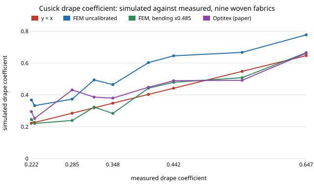

The [`hanger-codesign`](../../research/hanger-codesign/) programme is building a
cloth simulator good enough to design a laundry robot's hangers. For a week its
test bench has been a simulated Cusick drape test. A 30 cm disc of fabric hangs
over an 18 cm support. The drape coefficient (DC) is the share of the ring
between the two that the fabric's shadow covers. The question so far was whether
the simulated DC holds still as the mesh gets finer
([yesterday](2026-11-17-hanger-drape-interval.md): yes, if you report an interval).
The question it could not ask was whether the DC is *right*. No reachable table
gave a measured DC alongside the bending, weight and stretch of the same fabric.

Today one did. Europe PMC serves the open-access full text of Petrak, Mahnić
Naglić, Rogale and Geršak (2021) in *Materials*
([doi:10.3390/ma14216259](https://doi.org/10.3390/ma14216259), CC BY 4.0). It
covers nine woven fabrics, from an 84 g/m² polyester to a 367 g/m² polyester-viscose.
For each it gives FAST and KES-FB bending, shear and tensile data, and a measured
Cusick DC on our exact geometry. The authors also simulated all nine in a
commercial garment CAD system (Optitex), which gives us a baseline.

## What we ran

We gave our triangle finite-element tier the paper's numbers and fitted nothing.
Bending is the geometric mean of warp and weft. Shear is FAST's value. Stretch
stiffness is the secant at 100 gf/cm. Each fabric got three random starts on a
2.5 mm mesh, and we kept the lowest-energy result. The predictions were
committed before the first solve. The run took 45 solves and about five
core-hours.

## What came out

The ranking is excellent. The simulated DC puts the nine fabrics in almost
exactly the measured order: Pearson r = 0.965, Spearman 0.967. Every one of the
paper's eight Optitex columns scores lower, at 0.85 to 0.94.

The absolute values are not. Our tier over-drapes every fabric, by 0.09 to 0.20
and by 0.14 on average. Its RMSE of 0.148 failed the registered bar of 0.08.
It is also not mesh-flat at these stiffnesses. These wovens are 2 to 13 times
stiffer in stretch than the jersey of the last week. Going from a 3.75 mm to a
2.5 mm mesh raises the DC by about 0.03, which makes the over-drape worse. That
is the direction membrane locking predicts.

The bias turned out to be almost one number. For each fabric we interpolated
between two solved bending values to find the factor on FAST bending rigidity
that would match the measurement. The answers ran from 0.32 to 0.61, with a
median of 0.47. We then fitted one shared factor on eight fabrics and predicted
the ninth, rotating through all nine. That gave an RMSE of 0.050. Solving all
nine at the shared factor of 0.485 gave RMSE 0.036 and r 0.969. That last figure
is fitted to the same nine points, so it is a one-parameter calibration, not a
prediction.

One prediction failed in a way worth showing. Partway through the run, three
fabrics solved with KES bending in place of FAST had all landed within 0.04 of
their measured values. So we registered that KES bending would score RMSE ≤ 0.05
across all nine. It scored 0.152. Two fabrics with suspect KES values
over-draped by 0.26 and 0.28, and a third under-draped by 0.20. The three
fabrics we had already seen were not typical. That is why predictions are
written before the data comes in.

## Two things the data said about itself

The paper's two instruments agree on shear once the units are converted. For
the first fabric, 0.41 cN/cm per degree is 23.5 N/m, against 23 N/m from FAST.
That check gave us confidence we were reading the columns correctly. On bending
they disagree by a factor of about 2.6 on seven fabrics. On the other two, the
KES weft values look like a misplaced decimal point. Separately, recomputing the
paper's correlation table from its own simulated values reproduces the FAST rows
but not the KES rows. "Measured bending rigidity" is therefore uncertain by more
than the calibration factor we found. Any simulator calibrated from a datasheet
inherits that uncertainty.

## What it means for the robot

The programme's hypothesis H3 says a cloth simulator must be calibrated before
its design choices can be trusted. On this tier that is now a measurement. The
uncalibrated tier gets the order right, but every absolute value is about 0.14
high. A one-number calibration fixes most of that. The next steps are a membrane
element that stays mesh-flat on stiff wovens, and a second, independent drape
table to test the 0.485 factor out of sample. After that comes re-running the
hanger choice on the calibrated solver.

Everything is in
[`experiments/m4a_measured_drape/`](../../research/hanger-codesign/experiments/m4a_measured_drape/),
and `results.txt` holds every number above. This is simulation checked against
published measurements; we measured no fabric ourselves.
