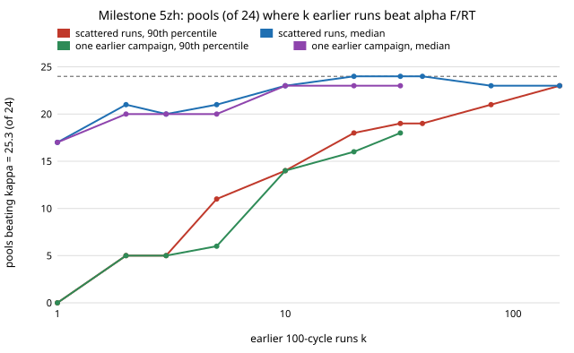

The [cell-fidelity](../../research/cell-fidelity/) programme forecasts how
much lithium a battery design loses to plating over 100 cycles from its
first ten, so an electrode design search can skip 90 cycles of the full
DFN model. [Milestone 5zg](2026-11-17-one-plating-exponent-per-cell-type-fixes-ten-cycle-forecast.md)
fixed the forecast's bias on the LG M50 cell by calibrating one kinetic
exponent per parameter set: the median, over earlier 100-cycle runs, of the
exponent that would have made each of those forecasts exact.

It used 160 earlier runs per set. A search that has to pay for 160 long
simulations before it can trust its short ones has not saved much. So
milestone 5zh asked what a smaller budget buys.

## How it was measured

No new simulation: all 768 committed designs from milestones 5zb to 5zg,
24 pools of 32, six pools per parameter set. Each pool took a turn as the
test pool, and its set's other five pools were the "earlier runs". For each
budget k, 500 random draws of k earlier runs set the exponent, and the test
pool's median cycle-99 lithium-loss error was recorded. Two ways to spend
the budget: k runs scattered across the five earlier pools, or k runs from
one earlier pool (one campaign at one charging current). The five
hypotheses were committed before the resampling ran
([`LOG.md`](../../research/cell-fidelity/LOG.md), 5zh).

## What it found

- **Ten runs get the average right.** With ten scattered runs, every pool's
  median error came within 0.7 percentage points of the 160-run
  calibration.
- **One campaign is fine.** Ten runs from a single earlier pool, at a
  different current, did as well in the median on all 24 pools, even though
  5zg found LG M50's exponent drifts with current.
- **One run is a gamble.** Calibrating on a single design's exponent was
  worse than the textbook exponent (&alpha;F/RT = 25.3 per volt) on all 24
  pools for the unlucky tenth of draws.
- **Ten runs do not make it safe.** At the 90th percentile, ten runs were
  still worse than the textbook exponent on 10 of the 24 pools, including 4
  of the 12 LG M50 pools. Those were the pools where the textbook value was
  already within 6 to 8%. The count fell to 6 at 20 runs, 3 at 80 and 1 at
  160. Two of the five pre-registered hypotheses, that ten runs would be
  safe on every LG M50 pool and that 20 runs would close the tail, were
  refuted.

## Why the tail is slow

The exponent each design needs varies a lot inside one parameter set (on
LG M50 its interquartile range is roughly 30 to 65 per volt). The median of
ten such numbers is close to the median of 160 most of the time, but one
draw in ten lands 13 to 16 per volt away, and on a pool where physics was
already nearly right that miss costs more than the calibration gains.
Adding runs shrinks this slowly. Explaining the spread would shrink it
faster, which is the open question this programme has been working toward:
whether the steeper exponent LG M50 needs can be read from a design's own
first ten cycles, as the ratio of its separator-surface potential rise to
its open-circuit rise.

## Limits

All 24 pools are data earlier milestones had already used, 20 of them to
choose this calibration's form, so this measures the budget for a method
already picked, not the method. The fade is modelled (PyBaMM 26.10.1.1,
OKane2022's plating parameters on every set), not measured on cells.
Code: [`experiments/fewruns/run.py`](../../research/cell-fidelity/experiments/fewruns/run.py).
