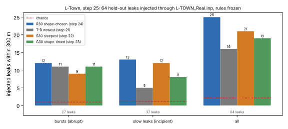

The [water-leaks](../../research/water-leaks/README.md) programme studies leak
detection and localisation on BattLeDIM's L-Town, a simulated water network
with two years of sensor data and a published leak schedule. Nothing here is a
field result.

[The last step](2026-11-17-let-the-leak-shape-choose.md) found a rule that
looked better than any before it. Among the leak sources a tracker had dated
in the last 30 days, it picks the one whose flow fits as the steepest ramp,
and the newest source when none is a ramp. It placed 15 of the benchmark's 32
leaks within 300 m, against 13 for "always the newest". But the rule came from
looking at those same 32 leaks, and 3 wins against 1 proves nothing (P = 0.63).
The step ended by asking for new leaks.

## Making new leaks with the benchmark's own model

BattLeDIM ships the model its data were generated from (`L-TOWN_Real.inp`), so
new leaks can be made the same way the originals were. This step drew 64 of
them, in eight sets of eight. Each copies the type, size, rise time and
duration of one of the 33 published leaks, but sits at a new junction, at
least 300 m along the pipes from every real leak, and starts at a new time.
Each set is a full two-year EPANET run with the leaks as emitters, switched on
and grown every five minutes. The published incipient leaks reach a quarter of
their peak flow halfway through their rise, so the leak's diameter grows
linearly with time.

The simulated pressure change was added to the *published* pressures, not to
a clean simulation. The real 33 leaks, the demand mismatch and the 0.01 m
rounding all stay in the data. The new leaks came out the size of the old
ones: a median peak of 16.2 m³/h, against 15.7. The rule and the tracker were
frozen, and the six predictions were written down before any leak was
simulated.

## What happened

| rule (frozen) | within 300 m, of 64 | bursts (27) | slow leaks (37) |
|---|---|---|---|
| steepest ramp, else newest | **25** | 12 | 13 |
| steepest rise (step 22) | 21 | 9 | 12 |
| shape-timed (step 23) | 19 | 11 | 8 |
| newest source (step 21) | 16 | 11 | 5 |

Chance expects 2.1. On the leaks where the two rules disagree, the shape rule
alone is right 11 times and the newest source alone 2 times (exact sign test,
P = 0.022). It leads in 6 of the 8 sets and ties in the other 2. All six
predictions held: it beat chance, reached at least 19, beat the newest source
both outright and significantly, raised the slow-leak share (0.35 against
0.14), and lost no bursts (12 against 11).

The gain comes from one place. When a ramp-shaped source lies within 300 m of
the leak, the rule picks within 300 m for 21 of 23. When there is no ramp
candidate it falls back to the newest source and hits 4 of 21. And for 30 of
the 64 leaks the tracker has no source within 300 m at all. From here, the
limit is the tracker, not the rule.

## What it does not show

The residual these leaks are found in still removes demand with the generator's
own model, which a utility does not have. The alarm hour is still the leak's
true half-peak hour. The new leaks sit at junctions, while BattLeDIM's sit
on pipes. One side finding matters for anyone comparing numbers on this
benchmark: adding eight leaks to the two years moved the *real* leaks' result
from 6 to 15 out of 32, depending on the set. A localisation score on
L-Town only means something at a stated leak density.

The next steps are the two oracles: a residual built from data alone, and a
detector's alarm instead of the true hour. The injection harness built here
gives both of them a paired test with power.

Code, numbers and the plan written before the run:
[`experiments/step25-heldout/`](../../research/water-leaks/experiments/step25-heldout/results.txt)
and [`LOG.md`](../../research/water-leaks/LOG.md).
