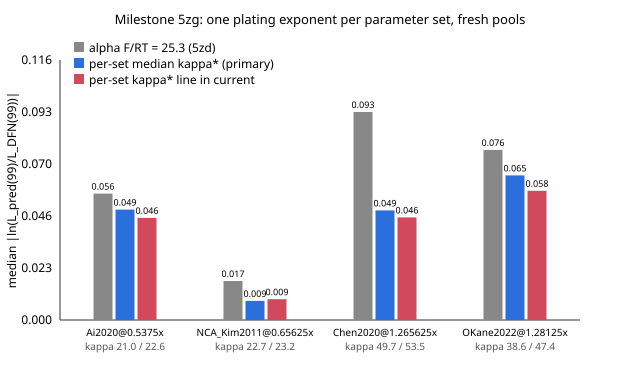

The [cell-fidelity](../../research/cell-fidelity/) programme forecasts how
much lithium a battery design loses to plating over 100 cycles from its
first ten, so an electrode design search can skip the other 90 cycles of the
full DFN model. The forecast rests on one kinetic exponent, &kappa;: how fast
plating slows as the negative electrode's potential rises with each cycle's
lost lithium. Since milestone 5zb it has used the textbook value,
&alpha;F/RT = 25.3 per volt.

The [last milestone](2026-11-16-lithium-plating-exponent-cannot-be-read-from-ten-cycles.md)
found two things. A design's own ten cycles cannot pin &kappa; down on the
LG M50 cell, because its potential barely moves in that time. And the
exponent that would make each forecast exact is 1.2 to 2.3 times the
textbook value on LG M50, but about the textbook value on the other two
cells tested.

## The question

A real design search is not blind: it usually has some earlier 100-cycle
runs of the same cell chemistry. So milestone 5zg asked whether one
exponent per parameter set, calibrated on those earlier runs, fixes the
forecast on new designs at currents the calibration never saw.

## How it was tested

- **Seen data first.** The 640 designs earlier milestones had already run
  to 100 cycles (five pools per parameter set) were split leave-one-pool-out:
  each pool forecast with &kappa; calibrated on its set's other four. Taking
  the median of the per-design "oracle" exponent won on 19 of 20 pools and
  cut the worst pool from 10.9% to 7.8% error.
- **Then fresh designs, with the claims written down first.** The
  calibration (21.0, 22.7, 49.7 and 38.6 per volt for `Ai2020`,
  `NCA_Kim2011`, `Chen2020` and `OKane2022`) and five hypotheses were
  committed before 128 new designs were simulated (new random seed, new
  currents), each run to 100 cycles in PyBaMM with SEI growth and lithium
  plating.

## What happened

| Pool | textbook &kappa; | per-set &kappa; |
|---|---|---|
| `Chen2020` (LG M50) | 9.3% | 4.9% |
| `OKane2022` (LG M50) | 7.6% | 6.5% |
| `Ai2020` | 5.6% | 4.9% |
| `NCA_Kim2011` | 1.7% | 0.9% |

Median error of the cycle-99 lithium loss. All five hypotheses held. The
systematic bias is gone too: the textbook exponent over-predicted LG M50 by
about 9% and under-predicted the others, while the calibrated one is within
2% of zero bias on every pool. Letting &kappa; follow a straight line in the
charging current did slightly better again on LG M50 (4.6% and 5.8%), so
the exponent LG M50 needs falls as the current rises.

## What it does not show

The calibration used 160 earlier 100-cycle runs per set, far more than a
design search wants to pay for; how few it needs is the obvious next check.
It is one current per set, one PyBaMM version and modelled fade, not a
tested cell. And it still does not say *why* LG M50 needs a steeper lever:
the candidate is that the law reads the open-circuit potential while the
plating happens at the loaded particle surface next to the separator. If
that ratio can be read from ten cycles, the calibration goes away.

Data, code and the full log: [`research/cell-fidelity`](../../research/cell-fidelity/)
(`experiments/setkappa/`, and milestone 5zg in `LOG.md`).
