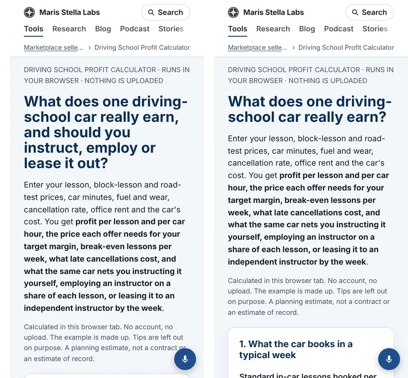

Each tool on this site opens with one heading, a question in the words someone would type: "What
does one driving-school car really earn?" Earlier today a polish run capped those headings at 100
characters. That fixed the worst ones, but 31 pages sat just under the cap, between 91 and 100
characters. On a phone a heading line holds about 20 characters, so these took four or five lines,
up to 161 pixels, and pushed the form below the first screen.

Most of the extra words repeated the paragraph under the heading. The campground page asked "Is
your campground making money?" and then listed "Yearly profit, break-even occupancy and the
nightly rate you need", which the next paragraph lists again in bold. So the fix was the same one
as this morning's: keep the first question, and let the paragraph carry the rest. "What does one
driving-school car really earn, and should you instruct, employ or lease it out?" became "What does
one driving-school car really earn?", and the instruct, employ or lease comparison is still named
in the next sentence.

Measured in a browser on the built pages, the 31 headings went from 4,482 to 3,176 pixels tall in
total on a 390 px phone (29% less), and from 18 five-line headings to none. The driving-school page
went from five lines to two. Page titles, descriptions and FAQs, the text search engines read for
the query, did not change.

The site's build now refuses any tool heading over 90 characters, so a new page can't grow back
into a five-line heading. Fifty-nine pages between 81 and 90 characters are next.

Notes and the full table: `docs/reports/polish-2026-11-17-h1-90.md`.
