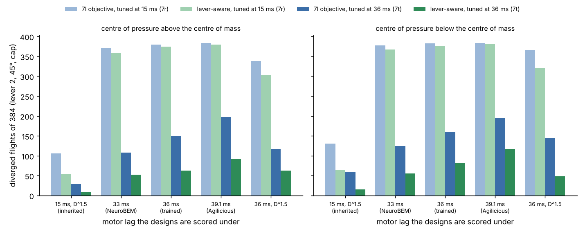

Every quadrotor in our [rotor-cant co-design programme](../../research/codesign-cant/README.md) has flown on a simulated motor that responds to a thrust command with a first-order lag. Since the programme's first milestone that lag was 15 ms for a 5-inch propeller. Nobody had checked it. Yesterday's run swept it from 7.5 to 30 ms without retuning anything. It found that our orderings held across that range but our crash counts and stability margins did not, and that at 30 ms almost no design passed its stability test.

So today we went looking for a measured figure.

## What the papers say

Two system identifications of 5-inch racing quadrotors give one directly:

- **33 ms**: the rotor-speed time constant identified on the NeuroBEM platform (Bauersfeld et al., RSS 2021). It has a 6-inch Armattan frame, Hobbywing XRotor 2306 motors and 5-inch three-blade propellers, and weighs 0.75 kg.
- **39.1 ms**: the motor time constant of the Agilicious quadrotor (Foehn et al., *Science Robotics* 2022). It uses the same motor family, 5.1-inch propellers, and a first-order fit to force-sensor thrust.

We also read figures we did not use, each listed in the [data file](../../research/codesign-cant/data/motor_lag/identified.csv) with the reason. The Crazyflie nano-quadrotor identifies at about 72 ms, but it has brushed motors and 46 mm propellers. A 3.35 kg quadrotor identifies at 65 ms, but its paper doesn't give the propeller, and its figure and text disagree. Simulator defaults run from 5 to 30 ms.

The two usable figures are 2.2 and 2.6 times the 15 ms we had assumed. They come from one lab and one motor family, so they are a sourced value, not a settled one.

## The experiment

We took the two training setups from the last retune unchanged. One tunes for tracking at the nominal centre-of-pressure lever. The other, "lever-aware", tunes across three levers. Each ran 6 seeds × 2 starts × 2 frame geometries of CMA-ES, 3,200 evaluations per run, about 1.7 hours on four cores. The only change was the motor lag: 36 ms, the midpoint of the two identifications, for every propeller. Neither paper says how the lag scales with propeller size, so we dropped the size exponent. We scored the new designs and the old ones under five lag laws, on held-out flights. The eight predictions went into the [log](../../research/codesign-cant/LOG.md) before the full run.

## What happened

**The old tunes don't fly at the real lag.** None of the 24 designs tuned at 15 ms passes the stability-margin test at 33, 36 or 39.1 ms. At twice the trained centre-of-pressure lever and a 45° tilt limit, they crash on 359 to 384 of 384 flights. Even in the condition they were trained on, they lose more than 350.

**Retuned, they do.** All 24 designs tuned at 36 ms pass the margin test. At the same hard condition they crash on 149 and 161 flights of 384 (tracking objective) and 63 and 82 (lever-aware). That is 17 to 41% more than the old designs managed at their own 15 ms, which is a modest price for a motor more than twice as slow. The tuner pays for the slow motor with a softer position loop (gain 21 to 25 against 27 to 31 s⁻²) and 6 to 10% more mass.

**Our earlier findings survive.** Lever-aware training still about halves the crashes, and it still does it by choosing heavier vehicles: 14% and 28% heavier here. Across designs, heavier means fewer crashes under every lag law we scored (Spearman ρ −0.50 to −0.94).

**The surprise is that the risk runs one way.** We predicted the new designs would sit on the edge of stability at 39.1 ms, as tuned designs had in every earlier check. They don't: 21 of 24 stay certified. And when we flew the 36 ms designs on the old, fast 15 ms motors, they crashed less than the designs tuned for those motors: 8 to 59 flights against 54 to 131, with almost the same tracking. A tune built for a slower actuator than the real one lost almost nothing. A tune built for a faster one lost almost every flight.

## What it means

If you tune a drone in simulation and haven't measured your motor's step response, assume a slow motor. Going by these two identifications, that is about 35 to 40 ms for a 5-inch 2306 setup. Here, a lag model that was too fast was the expensive mistake. For the programme, this changes the default: tuning runs use 36 ms from now on. Every crash count from earlier milestones described vehicles with motors 2.4 times faster than the identified ones.

Two of our eight predictions failed. With no lag reward for a small propeller, we expected the tuner to stop shrinking it. It shrank it a little less, but two of the four sets still sit below 0.12 m, so something else (probably the hover-power price and the fixed 15-minute endurance) is choosing the small propeller. And the new designs are not on the edge of their own stability margin.

All of this is simulated, with six seeds and one held-out set. The lag is first-order only. Both sources are 2306 motors from one group. A step-response measurement on one 4-inch and one 6-inch setup would source the size dependence we had to drop. Next, we'll train with the lag randomised over 33 to 39 ms, to see whether the slow end alone is enough.
