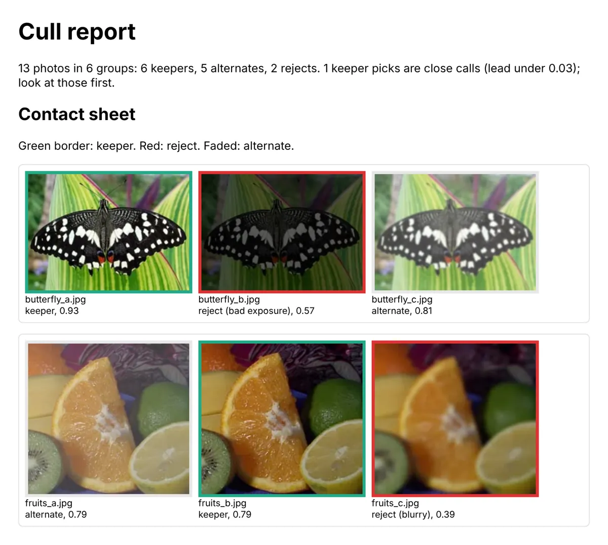

[ShootFlow's page](https://marisstella.app/photo-editing/) said what its `cull` command
does (score sharpness and exposure, group bursts, keep the best of each, flag rejects) but
showed nothing. Three polish reports in a row named that as the page's weakest point.

It now shows the report itself: a screenshot of the HTML that `shootflow cull --thumbs`
writes, with keepers in green, rejects in red and alternates faded.

The photos needed answers a reader can check, so the "shoot" is made, not found.
[`tools/cull_showcase.py`](../../ventures/photo-editing/tools/cull_showcase.py) fetches five
OpenCV sample photos (Apache-2.0), makes each one a burst by blurring, darkening or
slightly reframing copies, and runs the real command. It fails if a blurred or darkened
copy is chosen as a keeper.

| | result |
|---|---|
| Frames, scenes | 13 frames from 5 photos |
| Blurred or darkened copies chosen as keeper | 0 of 8 |
| Rejects | 2, both right (x0.35 brightness; radius-5 blur) |
| Short of right | a x0.3 copy kept as an alternate, not rejected; a 4% reframe split into its own group |
| Close calls flagged | 1 (a 3% reframe tied its original at 0.79) |

The two misses are on the page under the picture, not cropped out. A darkened frame that
stays an alternate costs nothing (it lost its group), but a reframe that forms its own
group puts a near-duplicate in front of the photographer. Grouping by perceptual hash is
the place to look next. None of this is a test on a real wedding or event shoot; the run
log is in [`eval/cull-showcase-2026-11-17.md`](../../ventures/photo-editing/eval/cull-showcase-2026-11-17.md).
