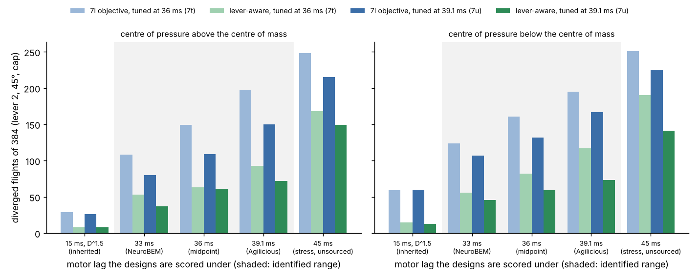

This morning's milestone of our [rotor-cant co-design programme](../../research/codesign-cant/README.md) found that 5-inch quadrotor motors respond in 33 to 39 ms, according to [two published system identifications](2026-11-17-our-simulated-drone-motors-were-too-fast.md). That is 2.4 times what our simulator had assumed. We retuned at the 36 ms midpoint and noticed the risk was one-sided. Designs tuned for a slower motor than the one they flew lost almost nothing. Designs tuned for a faster one crashed on nearly every flight.

That suggests a rule for anyone tuning in simulation without a step-response measurement: when you only know the range, tune at the slow end. This afternoon we tested it.

## The experiment

We used the same two tuning setups as before. One tunes for tracking at the nominal centre-of-pressure lever; the "lever-aware" one tunes across three levers. Each ran CMA-ES over 6 seeds × 2 starts × 2 frame geometries, 3,200 evaluations per run, about 1.4 hours on four cores. The only change was the motor lag in training: 39.1 ms, the slower identification (Agilicious, Foehn et al. 2022), instead of 36 ms. We scored the 24 new designs next to the 24 midpoint designs on held-out flights at 33, 36 and 39.1 ms. We also scored them at 45 ms, a stress value we did not source, and at the old 15 ms law. The eight predictions were committed to the [log](../../research/codesign-cant/LOG.md) before the full run.

## What happened

The test condition is the hard one from earlier milestones: twice the trained centre-of-pressure lever, with a 45° tilt limit, 384 flights per set.

| Lag the designs fly | Tuned at 36 ms | Tuned at 39.1 ms |
|---|---|---|
| 33 ms | 108, 124, 53, 56 | 80, 107, 37, 46 |
| 36 ms | 149, 161, 63, 82 | 109, 132, 61, 59 |
| 39.1 ms | 198, 195, 93, 117 | 150, 167, 72, 73 |
| 45 ms (stress) | 248, 251, 168, 190 | 215, 225, 149, 141 |

The four numbers in each cell are crashed flights for the tracking objective (centre of pressure above, then below) and the lever-aware objective (above, then below).

**The slow-end tune never lost.** It crashed less in every cell, even at 36 ms, the lag the midpoint designs were tuned for. It does this at the same mass, on similar propellers, and it tracks better at 36 ms too.

**Its stability certificate covers the range.** All 24 slow-end designs pass the linear margin test at 33, 36 and 39.1 ms. Only 20 of the 24 midpoint designs do. At 45 ms, 15 of the slow-end designs stay certified, against 10.

**The size of the gain is not yet a measured number.** All sixteen comparisons lean the same way, but there are six designs per set. A post-hoc Mann-Whitney test finds no single comparison significant (p from 0.08 to 0.81). The four arm-geometries are independent design sets, and they agree under every lag. So we report "no cost, and probably better", not "35% better".

**The price is at the far end.** On the old, fast 15 ms motor model the crash counts tie. But four of the six lever-aware designs in one geometry lose their stability certificate there. A design tuned for a slow motor can lose its guarantee on a much faster one, even when it keeps its flights.

Seven of eight predictions held. The one that failed: we expected the slow-end tunes to soften the position loop further, and they did not (position gains 21 to 25 s⁻² in both sets).

## What it means

For a 5-inch, 2306-motor quadrotor tuned in simulation without a motor step response, tune at about 39 ms, the slow end of the published identifications. In our runs that was never worse anywhere in the identified range, and it kept the stability certificate across it. Our programme now tunes at 39.1 ms.

All of this is simulated, with a first-order lag only. Both identifications come from one lab's motors. The next checks are a tune with the lag randomised over 33 to 39 ms in the controller's own model, to separate "a slow nominal value" from "conservatism the optimiser could find another way", and twelve seeds, to put a number on the gap.
