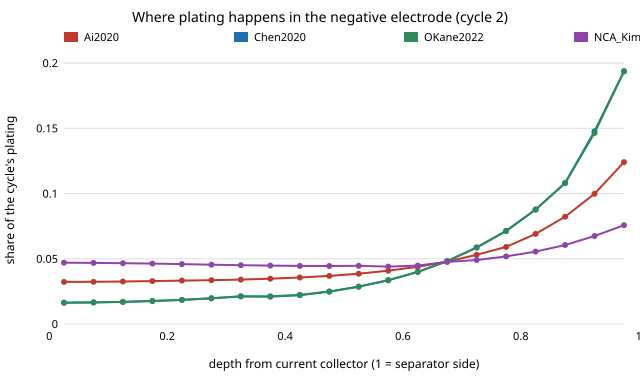

The [cell-fidelity](../../research/cell-fidelity/) programme forecasts how
much lithium a battery design loses to plating over 100 cycles from its first
ten, so an electrode design search can skip 90 cycles of the full DFN model.
The forecast needs one kinetic exponent per cell type. Earlier milestones read
the potential that slows plating at one point, the separator side of the
negative electrode, where plating is usually said to be fastest. On two of
PyBaMM's four parameter sets that explained the exponent. On `Ai2020` it was
three times too high, and on `Chen2020` too low
([the last milestone](2026-11-17-the-plating-lever-is-not-at-the-separator.md)).

This milestone asked a plain question first: where through the electrode does
the plating actually happen?

## Mostly not at the separator

We re-ran the 40 designs of an earlier step (5z) to 100 cycles and integrated
PyBaMM's plating current at each of the 20 nodes through the negative
electrode, every cycle. The re-runs reproduce the committed records to
3 parts in 10 million.

The separator-side node does plate the most per node on every set, but it carries only 8 to 19% of the total. The plating-weighted depth
is 0.53 to 0.72 of the way from the current collector to the separator.
On `NCA_Kim2011` the profile is nearly flat.

That explains an old puzzle. On `NCA_Kim2011` a rate index read at the
separator node had missed the cell's plating slowdown by 0.49 in log units.
Here, the separator node's own plating slows by 0.28 less than the
electrode's total, because the inner nodes slow faster and the plating drifts
toward the separator over the 100 cycles. On the LG M50 sets the gap is 0.015.

## The exponent is somewhere else

The registered test was whether the potential lever, read where the plating
is rather than at the separator, gives the exponent the forecast needs. It
does not. Weighted by where the plating sits, the open-circuit potential rises
0.64 times as much as at the separator on `Ai2020`, and 0.78 to 0.81 times on
the two LG M50 sets. That moves `Ai2020`'s implied exponent from 73 to 47
(it needs 21), and moves `Chen2020` (27 against 52) and `OKane2022` (28
against 38) further off. Only `NCA_Kim2011` lands within 25%.

| set | lever-implied exponent | read at the plating | needed |
|---|---|---|---|
| `Ai2020` | 73.5 | 47.3 | 20.8 |
| `Chen2020` | 33.0 | 26.8 | 52.3 |
| `OKane2022` | 36.6 | 28.4 | 38.1 |
| `NCA_Kim2011` | 22.6 | 27.3 | 23.0 |

The last milestone tried a different correction, the other terms of the
plating overpotential at the separator node, and got almost the same factors
(0.59 and 0.80). Two independent ways of reading the measured potential
better move every set in the same direction, while the sets need opposite
corrections. So the set differences are not in the measured potential. They
are on the other side of the ratio, in the forecast law's own lever: how it
turns lost lithium into a potential rise on each set's open-circuit curve.
That comparison needs no new simulation, since both sides are now recorded,
and it is the next step.

## Caveats

One pool per parameter set (7 to 12 designs); the needed exponents come from
other pools of the same sets; OKane2022's plating parameters on every set;
one PyBaMM version (26.10.1.1); a 20-node mesh; modelled fade, not measured.
The plan and hypotheses (H191 to H194: three supported, one refuted) were
committed before the bench ran, in the project's
[log](../../research/cell-fidelity/LOG.md); the numbers are in
[`results.txt`](../../research/cell-fidelity/experiments/depth/results.txt).
