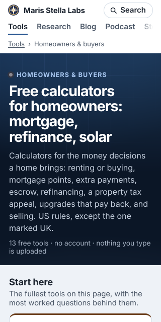
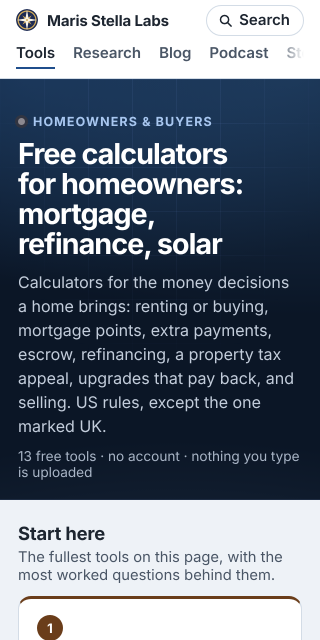

Open [Homeowners & buyers](https://marisstella.app/c/for-homeowners/) on a small phone and the
top of the screen says the same thing three times. The tab row has **Tools** underlined. Under it,
the breadcrumb reads "Tools › Homeowners & buyers". Under that, the page's eyebrow reads
"HOMEOWNERS & BUYERS", and then the heading names the page again.

At 320 px wide that header was 106 px: brand and Search, the section tabs, then the breadcrumb
on its own band. That is a sixth of a 640 px screen on every page, before any content starts.

## The rule

A breadcrumb is there to say where you are and give you a way up. On a phone the trail now hides
when it can do neither: when every link in it is either Home or the current section's own tab,
and its last crumb is the page the heading already names. That covers:

- the 31 audience pages and the category index ("Tools › …"),
- the research topic pages ("Research › Proper scoring & elicitation"),
- the category pages and the two story shelves ("Stories › Hearth & Horizon"),
- one-level pages like About, Ask, Feedback, Guides and Comparisons ("Home › About").

A trail with any other link stays, because that link is the only way up the reader has: a tool
page keeps "Homeowners & buyers › Rent vs buy", and a research project page keeps its topic.
Wide screens keep every trail as before, and nothing changes in the HTML that search engines
read, so the `BreadcrumbList` data is untouched.

## What it measured

Measured on the built site with Chromium, before and after, on 40 pages at three phone sizes:

| | before | after |
|---|---|---|
| Header height, 98 affected pages | 106 px | 79 px |
| First tool card, audience pages (any width) | | 27 to 28 px higher |
| Audience pages with a tool on screen at 360×780 | 30 of 31 | 31 of 31 |
| Audience pages with a tool on screen at 320×640 | 27 of 31 | 27 of 31 |

The four that still miss at 320 are the short pages with no "Start here" row, which need a
layout change rather than a shorter header. On the others, the first card used to start at the
very bottom edge with only its border showing; now its number badge is on screen.

The rule lives in one place, `renderSiteHeader` in `platform/pages/site-nav.mjs`, so a new page
gets it without anyone deciding again.
