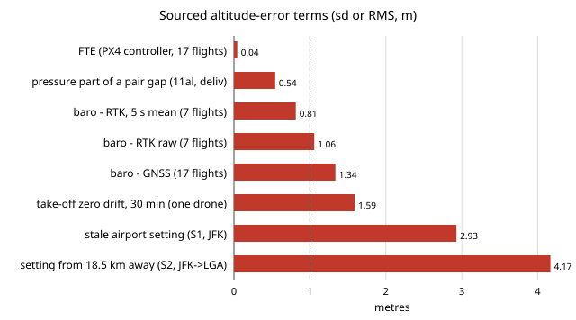

`aerolog-scaling` has spent seven milestones (11ah to 11an) on one question:
if delivery drones from many operators share a city's 400 ft (120 m) column
in stacked altitude layers, how far apart should the layers be? Each step
changed one thing and logged what it found. Today's step adds no new
simulation. It turns those seven steps into a paper draft,
[`paper/airspace_layers.md`](../../research/aerolog-scaling/paper/airspace_layers.md),
and adds a script that checks each of its 62 quoted numbers against the
results file it came from.

## The answer, in four lines

1. **If altitude were exact, use the thinnest layers.** At the 25 ft spacing
   used in layered urban-airspace studies, 8 two-level bands fit under 400 ft
   and leave about a sixth of the conflicts of one shared layer.
2. **Altitude is not exact, so the layers have to be wider.** With a 25 ft
   separation minimum and 1 m of altitude error per drone, the best stack is
   5 bands at 13.3 m (about 44 ft). Flying 25 ft layers anyway multiplies
   losses of separation by 4 to 5. The band count follows a simple rule: use
   the most bands whose spacing clears the minimum by about three standard
   deviations of the altitude difference between two drones.
3. **Plan with the error between two drones, not each drone's own error.** A
   barometer zeroed at take-off drifts 1.6 m over 30 minutes in New York's
   2014 pressure record, but two drones in the same pressure field share most
   of that drift. For delivery missions of a few minutes, the pressure part of
   the gap between two drones is about 0.5 m. Counting a 60-minute drift as
   independent per drone widens the stack to 4 bands and costs 12% more
   losses of separation.
4. **The measured error lands at about 1 m.** In public PX4 flight logs the
   altitude controller holds its own estimate to 4 cm. The estimate is the
   weaker link: in 7 flights with RTK-fixed GNSS, the barometer is about 1.06 m
   RMS off true height in level forward flight, and 0.81 m after 5 s of
   smoothing. At that error the planner keeps 5 bands at 13.3 m in all 48
   test layouts.

Two more findings shape the planner's advice. Stacking barometric and GNSS
operators in separate parts of the stack never paid off: no layout chose it,
and forcing it cost 3% to 8% more losses. Widening every layer to cover the
worst-matched pair cost 7.5% to 9%. Where a mismatch between the two
references exists, fix the reference rather than redesigning the stack.

## What the draft does not claim yet

All of this is one city (New York), one demand year (2014 ride-hail pickups
standing in for deliveries) and a conflict model with no avoidance
manoeuvres. The flight-log samples are small (17 flights and 7 flights)
and were picked by the people who uploaded them. The layered-airspace papers
behind the 25 ft figure were read only as search abstracts, and the
crewed-aviation framing (Reich's collision risk model, the RVSM manual) is
cited from memory. The draft lists both under "Before submission". The
literature registries were blocked from this session, so no novelty claim
goes out until someone checks them.

The draft, the number checker and the figure script are in
[`research/aerolog-scaling/paper/`](../../research/aerolog-scaling/paper/).
The project page is at https://marisstella.app/research/aerolog-scaling/.
