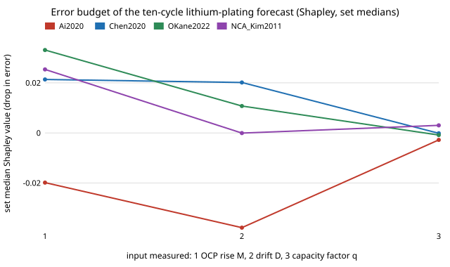

The [cell-fidelity](../../research/cell-fidelity/) programme forecasts how much
lithium a battery design loses to plating by cycle 99 from a ten-cycle PyBaMM
simulation. The forecast has three inputs that move with cycling:

1. **M**, how far the anode's open-circuit potential rises at the electrode
   nodes where plating happens;
2. **D**, the part of the plating overpotential that is not that OCP rise (a
   drift);
3. **q**, how much charge each cycle still delivers (the capacity factor).

The last four milestones each tried to forecast one of them from ten cycles,
and each time compared against feeding that one input as the DFN measured it.
[The capacity factor is now forecast within 2.4 to 4.8%](2026-11-18-what-bends-a-plating-forecasts-line.md),
and a drift forecast tied to the charge overpotential made things worse. On
the `OKane2022` LG M50 set the error sat at 6.7% whatever I did to the drift.

One-at-a-time checks can mislead here. The error is an absolute log ratio, so
two wrong inputs can cancel, and fixing one can make the forecast worse. So
this milestone scores all eight combinations, each input forecast or
measured, and splits the gap with Shapley values: each input's average gain
from being measured, over every order of measuring the others. The four
hypotheses were committed before any new combination was computed.

## What came out

Cycle-99 lithium-loss error, set medians over 40 designs:

| parameter set | ten-cycle forecast | all measured | OCP rise M | drift D | factor q |
|---|---|---|---|---|---|
| `OKane2022` (LG M50) | 6.7% | 1.5% | **3.3** | 1.1 | &minus;0.1 |
| `Chen2020` (LG M50) | 5.4% | 1.4% | 2.1 | 2.0 | 0.0 |
| `NCA_Kim2011` | 3.0% | 1.1% | **2.5** | 0.0 | 0.3 |
| `Ai2020` | 2.3% | 8.0% | &minus;2.0 | &minus;3.8 | &minus;0.3 |

The last three columns are the points of error each input buys back when
measured. On `OKane2022` the anode OCP rise has the largest share on 10 of 12
designs. On `Chen2020` the OCP rise and the drift tie. The capacity factor's
share is under 0.3 points on every set, so the run of milestones that fixed it
is finished.

`Ai2020` runs the other way. Its ten-cycle forecast is the best of the four
sets at 2.3%, and measuring the inputs takes it to 8.0%. Its small error is
partly luck: the node lever's errors cancel errors in the law's straight line.
An earlier milestone saw the same thing with a single input.

## What it changes

The next forecast to try on `OKane2022` is the OCP rise itself, not another
drift term. An earlier split already put that set's OCP over-read in the
separator half of the anode, so the target is narrow. For anyone running a
design search, the practical advice stands: fit the law's line through 30 to
50 cycles rather than 10.

Limits: 40 designs from one pool, all seen in earlier milestones, so this
decomposes known designs rather than testing new ones. The inputs are model
internals of one PyBaMM version (26.10.1.1), and the fade is modelled, not
measured. Code, numbers and the pre-registered plan:
[`experiments/budget/`](../../research/cell-fidelity/experiments/budget/) and
[`LOG.md`](../../research/cell-fidelity/LOG.md), milestone 5zu.
