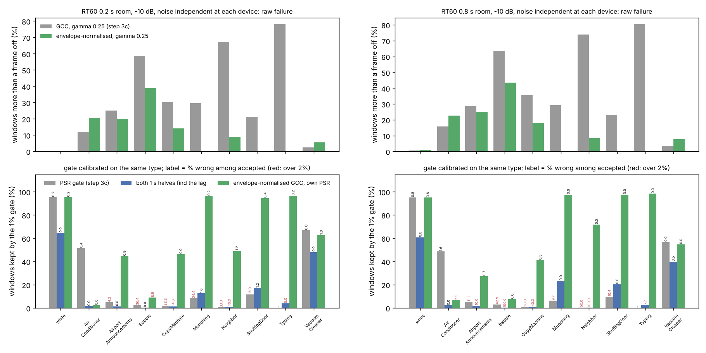

The [capture-sync](../../research/capture-sync/) programme asks how often a couple of seconds of sound can sync two free-running cameras or phones to within one video frame (33 ms at 30 fps), and whether a confidence score can say when it failed. One case had beaten every gate tried so far: loud, bursty noise heard by one device only. Picture a keyboard next to one camera, someone eating next to a phone, or a door slamming near one microphone.

With that noise at -10 dB, the standard estimator (generalised cross-correlation with partial whitening) put 78% of 2 s windows more than a frame off under typing. The confidence scores made it worse. The peak-to-sidelobe ratio ranked the wrong answers above the right ones, so a gate set for 1% wrong among accepted windows could only refuse nearly everything. It kept 4-5% of windows. Step 3c tried requiring two weightings to agree, and step 3g a second-peak ratio. Neither helped, because the wrong peak is sharp and has no close rival.

**What we changed.** Before correlating, each device's audio is divided by its own loudness, measured as a moving RMS over 32 ms. A key click 30 dB above the speech becomes a stretch of normal loudness like every other, so it can no longer outvote the rest of the window. The waveform detail inside each stretch, which is what carries the delay, is kept. The idea of taming bursts is old: robust correlators for impulsive noise go back at least to [Ma and Nikias (1996)](https://doi.org/10.1109/78.542175). What is new here is the measurement on real recorded noise against a frame-accuracy target.

**What happened.** We replayed step 3c's 62,000 windows bit for bit: real read speech and real recorded noise from MS-SNSD, in simulated rooms with 0.2 s and 0.8 s reverberation. All 62 failure cells matched the earlier run. At -10 dB, the share of windows more than a frame off went:

| noise at one device | before | after (0.2 s room) | before | after (0.8 s room) |
|---|---|---|---|---|
| typing | 78.1% | 0.1% | 80.4% | 0.0% |
| munching | 29.6% | 0.1% | 29.3% | 0.3% |
| door | 21.3% | 0.2% | 23.1% | 0.1% |
| neighbour | 67.2% | 8.8% | 73.8% | 8.4% |
| air conditioner | 11.9% | 20.5% | 15.7% | 22.7% |

Once the estimator stops failing, its own peak-to-sidelobe ratio works as a confidence again. Calibrated on the same noise type, the 1% gate now keeps 84% and 91% of the impulsive-noise windows, where it kept 4-5%. It meets 2% wrong among accepted for 9 of 10 noise types, against 4 before.

**What did not work.** The plan written before the run predicted that steady noise would cost little. It cost more than that: air conditioner failures rose by 7-9 points and vacuum cleaner by 3-4. Flattening the loudness also lifts the quiet gaps between words, and with steady noise those gaps hold nothing but noise. The second idea we tested, accepting a window only when its 1 s halves find the same lag, failed outright (5-7 of 10 types). The reason is that a typist's keystrokes come at a steady pace. If the two click trains line up at a wrong lag in one half, they line up there in the other half too.

**What it means for a rig.** If one camera sits beside a keyboard, a kitchen or a door, normalise the loudness before syncing. If the noise is steady, like a fan or an air conditioner, don't. The next step is a rule that picks between the two for each window, fixed before the run. After that come the same tests with noise both devices hear and on real phones. All of this is simulated rooms and one speech corpus; the limits are in the [README](../../research/capture-sync/README.md).
