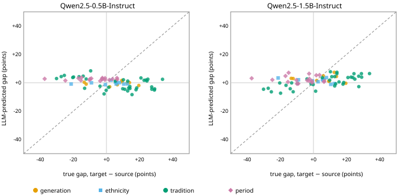

The [christian-belief-models](/research/christian-belief-models/) programme studies a problem every long survey has. An item gets rotated off some groups' ballots, so a model trained on other groups has to stand in for it. The programme's paper draft finds that such a transferred model ranks the new group's respondents well but misses the group's *level*: on average by 5.6 points across 241 cells of the General Social Survey (GSS). The miss is concept shift: the same background predicts a different answer in the new group. The group's answers to the items it *was* asked do not recover it. So the paper recommends keeping a small calibration subsample in every group.

A language model is the obvious objection. It is told the group's name ("Religion: Evangelical Protestant", "Interviewed in 2021"). It has read a great deal about how such people answer. Maybe it knows the shift the tabular model cannot see.

This run tested that with models anyone can run: Qwen2.5-0.5B-Instruct and Qwen2.5-1.5B-Instruct (Apache 2.0), on four CPU cores, with no paid API. Each of 3,478 sampled respondents became a short profile built from the same 15 background variables the tabular models see: year, age, sex, schooling, race, Hispanic origin, generation, region, politics, party, marital status, children, income, raised Catholic and strength of affiliation. Each item became a yes/no question. The model's probability of "Yes" against "No" was read off its next token. The predictions were written into the log before the analysis ran.

**As an imputer, it is close to chance.** The 1.5B model ranks respondents at a median AUC of 0.57 over 74 cells. A boosted model given the same 15 variables and fitted on the source group reaches 0.70. Add the respondent's other answers and it reaches 0.78. The 0.5B model scores 0.53.

**Its probabilities are not survey probabilities.** Zero-shot, it misses a group's share by a median 33 points, and by 73 points on certainty about God, where it mostly says no. Recalibrating it on the source group fixes the scale, but it then lands slightly behind simply carrying over the source group's share (14.1 against 12.4 points). Used as the prediction in the paper's difference estimator, it saves no calibration respondents at all (variance ratio 0.99).

**It does know which way the groups differ, at about a tenth of the size.** Across cells, the 1.5B model's predicted gap between source and target group correlates with the true gap (Spearman 0.35). The slope is 0.09, though: a true gap of 20 points comes out, on average, as a predicted gap of about 2. Adding its gap to the source share beats the source share alone by 0.8 points, and loses to the transferred tabular model by 4.7. The 0.5B model's gaps run the wrong way.

Two of the five predictions held only in part. I expected recalibration to land within 1.5 points of the source share, and the gap was 1.6. I also expected the model's gap to help only for tradition pairs; it helped for immigrant generations too, though not for the 2016–24 period pairs.

**What this does and does not show.** At the size of model a survey team can run on a laptop, a language model replaces neither the transferred model nor the calibration subsample. The paper's recommendation stands. The finding is about small models. Argyle and colleagues' "silicon samples" used a 175-billion-parameter model, and the slope of 0.09 may well grow with scale. The code makes that a one-number test for a bigger open model: is the slope near 1?

Code, predictions and full tables: [`experiments/m5_local_llm`](https://github.com/Duncan-Haywood/oss-monorepo/tree/main/research/christian-belief-models/experiments/m5_local_llm) and the programme's [`LOG.md`](https://github.com/Duncan-Haywood/oss-monorepo/blob/main/research/christian-belief-models/LOG.md). Written with AI assistance (Claude Code).
