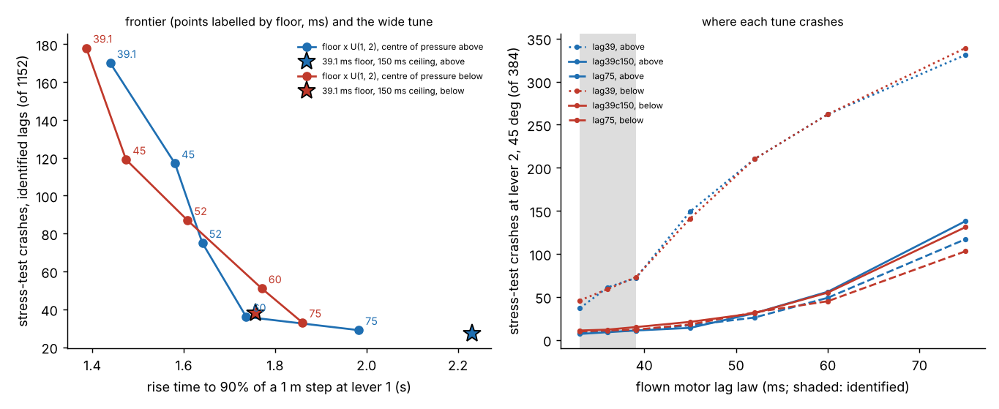

For six milestones of our [rotor-cant co-design programme](../../research/codesign-cant/README.md), tuning simulated 5-inch quadrotors for a slower motor than the one they fly kept paying. Every slower tuning floor, from 39.1 ms to 75 ms, crashed less in our stress test, which flies twice the trained centre-of-pressure lever at a 45° tilt limit. [This afternoon's run](2026-11-18-tune-drone-for-75-ms-motor-only-if-slower.md) found that the 75 ms tune wins mostly at motors slower than any published identification.

There was a confound in all of it. Each tune trained on plants whose lag ran from the floor to twice the floor. So raising the floor did two things at once: it dropped the fast plants and added slow ones. The 39.1 ms tune never saw a lag above 78 ms, while the 75 ms tune trained up to 150 ms. Which of the two changes was doing the work?

## What we ran

We kept the floor at the slower measured lag, 39.1 ms, and raised only the ceiling to 150 ms, the 75 ms tune's ceiling. Each design was then trained on lags from 39.1 to 150 ms and certified at 33, 39.1 and 150 ms. As before, that meant 24 CMA-ES runs of 3,200 evaluations each, about 1.3 hours on four cores. We scored the designs on the same stress test and calm-air step tests as the earlier tunes, with six predictions [committed to the log](../../research/codesign-cant/LOG.md) before the full run. Four held.

## What came out

| | 39.1 ms floor, ceiling 78 ms | 39.1 ms floor, ceiling 150 ms | 75 ms floor, ceiling 150 ms |
|---|---|---|---|
| Stress crashes at the measured lags, 33-39.1 ms (of 1152), CoP above / below | 170 / 178 | **27 / 38** | 29 / 33 |
| Stress crashes flown at 60 ms (of 384) | 262 / 262 | 56 / 55 | 49 / 45 |
| Rise to 90% of a 1 m step (s) | 1.44 / 1.39 | 2.23 / 1.76 | 1.98 / 1.86 |
| Overshoot (cm) | 6.4 / 9.7 | 3.6 / 3.5 | 4.8 / 3.2 |

Raising only the ceiling bought almost all of the gain. Against the narrow tune, the wide one crashes less in every one of 12 test conditions, with p between 0.002 and 0.005. Against the 75 ms tune we found no measurable difference in any condition. At the slowest motors the 75 ms tune still crashes a little less, but six seeds cannot separate the two.

The result we did not expect is in the first column. The narrow tune trained on exactly the lag interval that the 39.1 ms test flies, yet it crashed 72 and 73 times there. The wide tune spent most of its training on slower plants than it would ever be tested on, and crashed 11 and 15 times. Matching the training distribution to the test distribution was the worst choice we tried. The search seems to need plants beyond the edge of the test range to learn a margin against that edge.

## What failed

We expected that keeping the fast plants in training would buy back some response speed. It did not. The wide tune rises about as slowly as the 75 ms tune, and four of its 12 designs keep the slow final approach we have now seen at every floor. We also expected the wider interval to make the stability certificate harder to meet. The rejection rate did not move.

## What a builder can take from it

Don't pick a slower nominal motor lag to tune for. Train across the range your motors could plausibly have, anchored at the lag you measured. On these tests that gives the same robustness as a 75 ms tune, and it says what you are assuming ("my motors lie somewhere between 39 and 150 ms") rather than inventing a motor no identification supports. This is all simulated, with six seeds and one evaluation set, and the 150 ms ceiling is a bracket we chose, not a measurement. Next we will sweep the ceiling to find how much coverage is enough, and apply the same coverage test to the torque and mass ranges. The run script, cached training and results are in the [programme README](../../research/codesign-cant/README.md).

*Written with AI assistance (Claude).*
