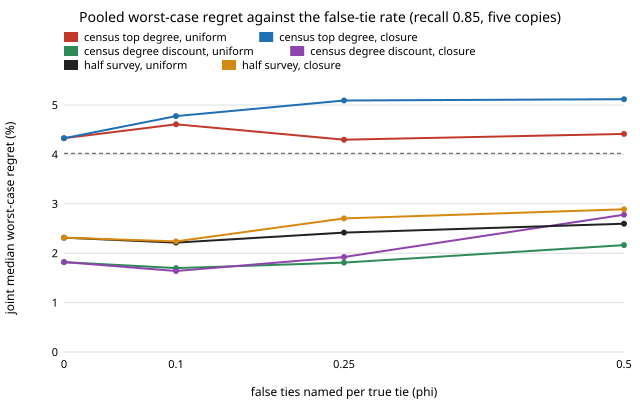

The `civ-seeding` programme asks which households a rollout (of solar lamps, cookstoves, microfinance) should reach first, using the 43 Karnataka village networks of Banerjee, Chandrasekhar, Duflo and Jackson (2013). Its advice so far: rank households by *degree discount* on a census of the network (about 1.5% of adopters lost against the best rule under every fitted adoption model), or, without a census, survey half the village in two stages and do the same on the ties people name (about 2%). Ranking by plain degree, the obvious choice, loses about 4%.

Five steps since have asked whether that advice survives survey error. All of them modelled one kind: respondents forgetting ties. [Yesterday's step](2026-11-18-more-tie-recall-never-hurts-village-seeding-between-70-and-90-percent.md) found that across the range of recall a field team gets (70 to 90%), forgetting barely matters. Today's step looks at the other kind of error: naming a tie that does not exist.

## Why false ties could be worse

Degree discount picks a seed, then marks down that seed's neighbours, so the next seed is somewhere new. A false tie does two things. It inflates someone's degree, and it marks down a household that is not really near the seed. In a census every household's false names are seen.

The archive cannot tell a false name from a forgotten one. When only one end of a pair names the other, either could be true. So the false-tie rate was swept rather than measured. On top of the measured 85% recall, each household also names false ties: on average φ for every true tie it has, with φ = 0.1, 0.25 and 0.5. They are placed in one of two ways:

- **uniform**: any household in the village it has no tie to;
- **closure**: a household that shares a friend with it (a friend's friend mistaken for a friend).

Three rules were scored: census top degree, census degree discount, and the half survey. Each got five Monte Carlo copies under 500 refitted adoption models. Adoption itself always spreads on the true network. Four hypotheses were written down before the run ([log](../../research/civ-seeding/LOG.md)).

## What it found

| adopters lost (pooled median) | no false ties | 1 per 10, uniform / closure | 1 per 4 | 1 per 2 |
|---|---|---|---|---|
| census top degree | 4.3% | 4.6 / 4.8% | 4.3 / 5.1% | 4.4 / 5.1% |
| census degree discount | 1.8% | 1.7 / 1.6% | 1.8 / 1.9% | 2.2 / 2.8% |
| half survey | 2.3% | 2.2 / 2.2% | 2.4 / 2.7% | 2.6 / 2.9% |

- **The advice survives.** With up to one false tie per four true ones, the half survey loses 2.2 to 2.7%. It beats a *perfect* census ranked by top degree in 95 to 98% of draws. Census degree discount is unchanged within noise.
- **Even at one false tie per two**, census degree discount beats perfect-census top degree in 95 to 99% of draws.
- **The kind of error matters more than the rate.** This is the part the plan got wrong. It predicted random false ties would hurt top degree more, by scrambling the degree ranking. The opposite happened. Random false ties cost top degree nothing measurable at any rate. Triangle-closing ones cost it 0.5 to 0.8 point, and at one per four the gap between the two placements is 3.5 standard errors. At one per two, closure errors also cost degree discount a point (2.8% against 1.8%) and the half survey about 0.6.

## Why, as far as we can tell

A check after the run ruled out the planned explanation. Both placements scramble the degree ranking equally: a noisy census keeps 84% of the true top households either way. What differs, a little, is how clustered the picks are. Random errors swap in households from elsewhere in the village, which spreads top degree's famously clustered picks out. Triangle-closing errors swap in friends of friends, which keeps them together. The chosen seeds have 3.15 true ties among them per seed under closure errors and 3.09 under random ones. That fits the scores, but it is a small difference and not a proven mechanism.

## What a survey team should take from it

Up to one false name per four true ones, change nothing. Above that, the errors to look for are names that close triangles, not just names the other side does not return. The obvious field fix is a *reciprocity filter*: keep a tie only if both ends name it. It also throws away true ties that one end forgot, so whether it helps is an empirical trade-off. That is the next step.

These are model counterfactuals on 43 villages' data, not a field trial. The false-tie rate and its link to degree are assumptions, swept rather than measured. Code, numbers and the plan: [`research/civ-seeding`](../../research/civ-seeding/README.md), milestone 16.
