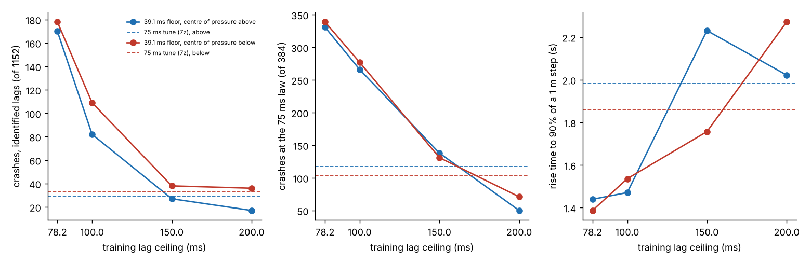

This afternoon's run of our [rotor-cant co-design programme](../../research/codesign-cant/README.md) [found](2026-11-18-drone-tune-wide-lag-range-beats-slow-nominal.md) that a simulated quadrotor gets robust by training across a wide range of motor lags, anchored at the lag that was measured, not by tuning for a slower motor than it has. It trained from the measured 39.1 ms up to 150 ms. The 150 ms figure was a bracket we picked, so the obvious next question was how wide the range has to be. We also wanted to know whether a wider range costs anything.

## What we ran

We kept the floor at 39.1 ms and retrained the same lever-aware design with lag ceilings of 100 ms and 200 ms. That is 48 CMA-ES runs of 3,200 evaluations, about two hours on four cores. We scored the new designs next to the earlier 78.2 ms and 150 ms tunes and the 75 ms tune. The stress test flies twice the trained centre-of-pressure lever at a 45° tilt limit, and the response tests are a 1 m step and 3 and 6 m/s wind steps. Seven predictions went into the [log](../../research/codesign-cant/LOG.md) before the full run. Four held.

## What came out

| Training lag ceiling | 78.2 ms | 100 ms | 150 ms | 200 ms |
|---|---|---|---|---|
| Stress crashes at the measured lags, 33-39.1 ms (of 1152), CoP above / below | 170 / 178 | 82 / 109 | 27 / 38 | **17 / 36** |
| Stress crashes flown at 75 ms (of 384) | 331 / 339 | 266 / 277 | 138 / 131 | **50 / 71** |
| Rise to 90% of a 1 m step (s) | 1.44 / 1.39 | 1.47 / 1.54 | 2.23 / 1.76 | 2.02 / 2.27 |
| Mass (kg) | 1.42 / 1.36 | 1.42 / 1.33 | 1.45 / 1.42 | 1.55 / 1.53 |

We predicted that 100 ms would buy most of the gain. It bought about half. Against the 150 ms tune, the 100 ms tune crashes more in 11 of 12 test conditions (p between 0.002 and 0.046). The knee sits between 100 and 150 ms, roughly three to four times the measured lag.

We also expected that going past 150 ms would start to cost robustness inside the measured range. It did not. At the measured lags the 200 ms tune cannot be told apart from the 150 ms one. At slow motors it is much better: it crashes about half as often at 75 ms and beats the tune built for 75 ms.

## Where the price shows up

The cost is response, not crashes. The 100 ms tune rises as fast as the narrow one. The 200 ms designs are 5-7% heavier and have lower position gains, and half of one geometry's designs never settle within 5 cm of a step. The widest range is also the hardest to certify in training: 20% and 17% of candidates were rejected, against 15% and 13% at 150 ms. So the ceiling is a dial between robustness to slow motors nobody has measured and how quickly the drone gets where it is going. It is not a free choice.

## A mistake we caught

The committed scoring script for one prediction, that slow designs would grow with the ceiling, read the wrong gain field from the results. It compared a stress-run quantity, not the response-test position gain that the prediction's reference numbers came from. We fixed it after the run and say so in the log. On the corrected field the prediction holds, but its cutoff of 8 was badly chosen: most designs in every set fall below it. The median gain does fall steadily with the ceiling, which is the trend the prediction was after.

## What a builder can take from it

When you randomise motor lag to train a controller, anchor the range at the lag you measured and run it to at least about four times that. Go wider only if your motors could really be that slow, and expect a slower, softer final approach in exchange. This is all simulated, with six seeds, one evaluation set, one controller arm and three ceilings, none of them sourced. Next we will try a floor on position gain during training. Its aim is to keep the 200 ms tune's slow-motor robustness without its slow approach.

*Written with AI assistance (Claude).*
