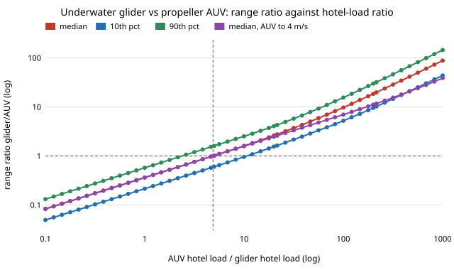

The [marine-hull programme](../../research/marine-hull/README.md) ranks the body types a small
survey craft can use by how far they go per kWh. One comparison in it is between a buoyancy-driven
underwater glider and a propeller AUV. It used to be told as three table rows. This step draws it as
a curve, for the paper draft's third figure
([`paper/main.tex`](../../research/marine-hull/paper/main.tex)), and the curve turned up something
the rows had hidden.

## The question

People usually describe a glider as slow but efficient. The programme's earlier steps found that
the efficiency is not hydrodynamic. With equal hotel loads (sensors, computer, everything except
propulsion), the AUV moves each metre for less energy, and the glider never has the longer range.
The glider wins because it carries a few watts of hotel load where an AUV carries tens to hundreds.
So the natural x-axis is the ratio of the two hotel loads.

## What the curve shows

We used the 2,430 glider and AUV cases from milestone 4b: Slocum lift and drag coefficients from
the MIT-licensed gliderflight package, three AUV hulls, pump efficiencies and cycle overheads,
with the code unchanged. The AUV's hotel load was set to x times the glider's, for x from 0.1 to
1,000 ([`results_glider_hotel_curve.txt`](../../research/marine-hull/experiments/results_glider_hotel_curve.txt)).

- **Crossover:** the glider's median range equals the AUV's at a hotel ratio of **4.87**. The share
  of cases the glider wins passes 10%, 50% and 90% at ratios of 2.38, 4.88 and 10.83.
- **Below the crossover:** when the AUV carries almost no hotel load (ratio 0.1), the glider's
  median range is 0.083 of the AUV's. Propeller drag is cheap at the AUV's best speed.
- **Above the crossover:** the glider's lead grows as about the 2/3 power of the ratio. The
  log-log slope is 0.645 between ratios 1 and 10. That is the exponent you get by minimising
  drag energy, roughly v^1.8, plus hotel energy per metre, P/v.

## The prediction that failed

We wrote four expectations down before the run, in the
[log](../../research/marine-hull/LOG.md). The crossover and its quantiles matched the earlier
break-even numbers. The third expectation failed: we predicted a slope of 0.60 to 0.70 between
ratios 20 and 200, and got **0.850**.

The cause is the speed grid. Milestone 4b only let the AUV fly at up to 1.5 m/s. At high hotel
load the AUV's best speed is faster than that: above 1.5 m/s in 56% of cases at ratio 20 and in
all of them at 200. Held below its best speed, the AUV looks worse than it is. We reran with speeds
up to 4 m/s, as a post-hoc check labelled as such. The slope drops to 0.653, and the crossover does
not move (4.87). So the ceiling only flattered the glider where it already wins at least 99.88% of
cases. No earlier verdict changes, but any row quoted at ratio 20 or above should come from the
wider grid.

## Where a real AUV sits

A REMUS-100-class AUV's vendor endurance implies 104 to 175 W of non-propulsion load. Against a
glider's 0.7 to 5 W, that is a ratio of 21 to 250, where the glider wins at least 99.92% of the
modelled cases. That is why the glider's reputation holds up in practice. The reason is the hotel
budget, though, not the hull. An AUV built to run on a glider-sized sensor budget would be a
different comparison.

Limits: these are modelled AUV hulls, not a fielded vehicle. Flight is steady, with no surfacing
or current, and both carry the same battery. The glider's own hotel loads are a swept grid, not
sourced per vehicle.
