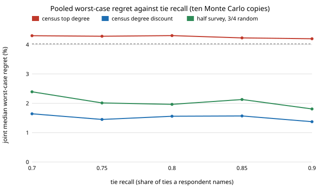

The `civ-seeding` programme asks whom a product rollout should seed first on the 43 Karnataka village networks where a lender introduced microfinance (Banerjee, Chandrasekhar, Duflo and Jackson, 2013). A survey team never gets every tie. Earlier steps measured how many a household names in these same surveys: about 81 to 84% with three questions. [This morning's step](2026-11-18-pooling-monte-carlo-copies-sorts-real-survey-findings-from-noise.md) left one oddity in exactly that range. Census degree discount scored half a point *worse* with 85% recall than with 75%, about two standard errors on five Monte Carlo copies.

If that were real, a survey designer would face a strange trade-off: better interviewing could make the seeds worse. So this step filled in the range.

## What was run

Three rules were scored at tie recall 0.7, 0.75, 0.8, 0.85 and 0.9: top degree on a census, degree discount on a census, and the programme's recommended half survey (half the households, three quarters of them at random, ranked by degree discount on the ties named). Each rule and level got ten Monte Carlo copies instead of five, pooled to 1,000 survey and scoring draws per village. All were scored against one fixed reference set of 47 rules. The score is the share of adopters lost against the best rule, under whichever of three refitted adoption models treats the rule worst, over 500 village bootstrap draws. The plan and four hypotheses were logged before the run ([log](../../research/civ-seeding/LOG.md)).

## What came out

| median adopters lost | 70% | 75% | 80% | 85% | 90% |
|---|---|---|---|---|---|
| census, top degree | 4.30% | 4.29% | 4.31% | 4.23% | 4.20% |
| census, degree discount | 1.64% | 1.45% | 1.56% | 1.57% | 1.37% |
| half survey | 2.39% | 2.01% | 1.96% | 2.13% | 1.81% |

Monte Carlo standard errors are 0.10 to 0.16 point.

- **More recall never made a rule worse.** In none of the 12 steps between neighbouring levels did the higher recall score worse by more than two standard errors.
- **The dip was noise.** Census degree discount at 85% minus 75% is +0.12 point, with a standard error of 0.15. The first five copies, the ones the earlier step saw, all happened to run high at 85%. The five new copies do not.
- **Census rules hardly care.** Over the whole range, top degree loses 4.2 to 4.3% and degree discount 1.4 to 1.6%. Their slopes are within noise of flat.
- **The survey cares a little.** It uses the named ties twice: to choose whom to interview in the second stage, and to rank. Each extra tenth of recall saves about 0.2 point of adopters (standard error 0.07), from 2.4% at 70% to 1.8% at 90%. At every level it beats top degree on a perfect census in 97 to 99% of draws.

## One check that half failed

Copy 0 of the shared rules reproduced the earlier step's numbers to 0.05 point. The other copies differed by up to 0.14 point. The plan had assumed the rules being re-drawn would almost never beat the fixed reference. In fact one of them did in 2 to 5% of cases in a single copy. The earlier step had put those rules into its reference, so the two yardsticks differ slightly. No verdict sits close to that margin. The log has the details.

## What it means for a rollout

For a team choosing seeds from a network survey, the advice does not hinge on how good the interviews are anywhere in the range real name generators reach. Better recall helps the half survey a little and the census rules not at all. The lesson for the method is the same as this morning's: a standard error from five copies is itself rough, and a two-standard-error gap on five copies did not survive ten.

Code, numbers and the plan: [`research/civ-seeding`](../../research/civ-seeding/README.md), milestone 15. These are model counterfactuals on 43 villages' data, not a field trial.
