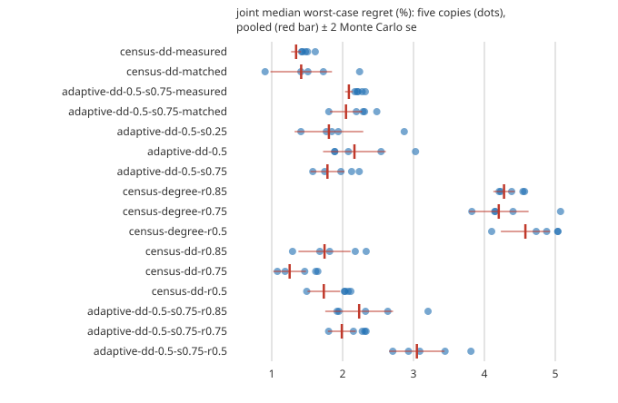

The `civ-seeding` programme asks whom a product rollout should seed first on the 43 Karnataka village networks where a lender introduced microfinance (Banerjee, Chandrasekhar, Duflo and Jackson, 2013). [Yesterday's step](2026-11-17-a-seeding-surprise-that-was-monte-carlo-noise.md) found that one finding, uneven forgetting helping a census-based rule, was Monte Carlo noise. It also found something larger. Re-run with fresh random numbers, one randomised rule's score can move by half a percentage point. The bootstrap intervals the programme reports do not include that error. Two earlier findings rest on gaps of about that size, so today's step re-tested them.

## What was run

Sixteen randomised seeding rules (survey designs and censuses that forget ties) were each re-drawn four more times. Each re-draw used fresh surveys and fresh simulation runs. The 500 bootstrap draws that refit the adoption models stayed fixed. The five copies were then pooled into one score per rule, which works out to 500 survey draws per village instead of 100. Each pooled score gets a Monte Carlo standard error: the spread of the five copies divided by √5. The plan and four hypotheses were written down before the run ([log](../../research/civ-seeding/LOG.md)).

The score is the same as in every step since milestone 6: the share of adopters a rule loses against the best rule, under whichever of three fitted adoption models treats it worst.

## What survived

- **Forgetting more ties costs more.** Milestone 11 had found something odd: some rules did *worse* when respondents remembered three quarters of their ties than when they remembered half. Pooled, that is gone. Forgetting half the ties costs census degree discount 0.5 point more than forgetting a quarter, and the half-village survey 1.1 points more, each over two standard errors. Census top degree moves the same way (0.4 point, 1.3 standard errors).
- **The headline advice.** Survey half the households, three quarters of them at random, and rank by degree discount on the ties people name. At the recall measured in these villages, that rule loses a median 2.2% of adopters, and it beats seeding the best-connected households of a full census (4.0%) in 97% of draws.

## What did not

Milestone 10 recommended spending three quarters of the survey at random rather than half. Pooled, that split scores 1.79% and the half split 2.17%. The gap is 1.7 standard errors, below the two the plan required. The opposite split, one quarter at random, scores 1.81%, the same as three quarters. So how the survey budget is split between the random stage and the most-named households matters little at this size. The advice stays "survey half the village". The exact split is not ranked.

## Two things nobody asked for

**One copy biases every score upward.** All 16 pooled scores sit 0.11 to 0.21 point (mean 0.15) below the average of their five copies. The cause is the scoring rule. Worst-case regret takes a maximum over three models and compares against the best of 53 rules, and noise pushes a maximum up. Every row the programme reported from milestones 10 to 13 carries this small upward bias.

**Pooling shrinks the error, but not to zero.** Five copies bring the standard error down to 0.03 to 0.24 point. The plan's bar was 0.15 for every rule, so that hypothesis failed. Getting the noisiest rules to 0.1 would take about 30 copies. Some fine distinctions stay open. Census degree discount scores 0.5 point worse at 85% recall than at 75%, about two standard errors. That is not yet a finding.

## Why this matters beyond villages

Any study that ranks randomised policies by a worst case over models has the same two problems. The resampling intervals miss the simulation's own noise, and that noise biases a maximum upward. The fix is cheap here: re-draw, pool and report the Monte Carlo error next to the bootstrap interval. It cost 26 minutes on four cores.

Code, numbers and the plan: [`research/civ-seeding`](../../research/civ-seeding/README.md), milestone 14. These are model counterfactuals on 43 villages' data, not a field trial.
