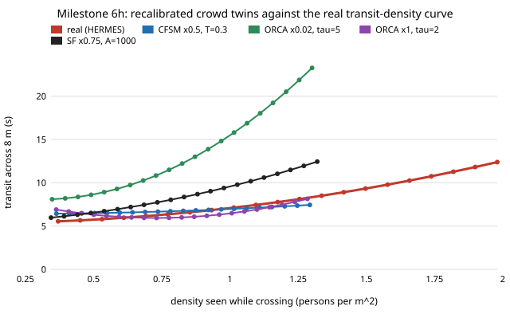

Earlier today the [society-lanes](../../research/society-lanes/) programme measured what one more walker
costs everyone else in a 3.6 m corridor, using the Jülich HERMES trajectories, and found that every crowd
twin we use for robot experiments gets that number wrong. The twins were 2 to 4 s too slow at a given
density. The obvious fix is to recalibrate them. This post is about what happened when we tried.

## One knob per model

Each of the three crowd-model families has one parameter that sets how much room a walker keeps, and none
had been fitted yet:

- **Social force** (Helbing and colleagues): the strength of the push between people, A, default 2000 N.
- **Collision-free speed** (Tordeux, Chraibi and Seyfried): the time gap a walker keeps to the person ahead,
  T, default 1.0 s.
- **ORCA**, the reciprocal collision-avoidance planner many robots run: the time horizon τ over which
  it avoids collisions, default 5 s.

We tried five values of each, bracketing the default on both sides, at nine crowd sizes and two entrance
widths. We scored each value by how far the twin's time to cross the 8 m section sits from the real curve
at the density the twin produced, then checked the chosen value on fresh seeds and on eight HERMES runs the
fit never used. We wrote down seven predictions before the run. Five were refuted, one held, and one
couldn't be tested.

## What worked

Two of the four settings now fit:

| Twin | Error before | Parameter chosen | Error after (fresh seeds) | Error on held-out runs |
|---|---|---|---|---|
| Collision-free speed | 8.87 s | T = 0.3 s | 0.54 s | 0.55 s |
| ORCA, fitted keep-right bias | 5.40 s | τ = 2 s | 0.58 s | 0.50 s |
| Social force | 2.85 s | A = 1000 N | 2.16 s | 2.33 s |
| ORCA, street-like bias | 6.06 s | no better value | 7.59 s | 8.13 s |

For collision-free speed and ORCA, the time a person takes to cross is now within about half a second of
the real crowd's, from 0.37 to 1.3 persons per m². That holds on runs the fit never saw, where each person
was told which exit to use. Social force doesn't get close with this knob. ORCA with a weak keep-right
bias jams at high counts whatever its horizon. One caveat on the collision-free speed fit: 0.3 s was the
smallest time gap we tried and the error was still falling, so the best value may be lower.

## What did not

Two things still stand between these twins and a number a fleet operator could use.

**The level is right, the slope is not.** At the density of the 0.9 m HERMES run (0.83 per m²), removing a
fifth of the walkers saves real people 0.40 s per crossing. The recalibrated collision-free speed twin says
0.19 s and recalibrated ORCA says 0.01 s. Each gets the time to cross right at that density (6.8 and 6.5 s
against a real 6.5 s) but responds too little to one more body. A fit on the level alone doesn't constrain
the slope, and the slope is what an operator adding robots to a busy corridor pays.

**The twin corridor can't get as crowded as the real one.** The dense HERMES run averaged 1.72 people per
m². No twin reached it, even with 120 walkers in the loop. Density stops rising near 1.3 per m², because the
model only lets a walker in where 0.55 m is free, so extra walkers wait at the entrance. That limit comes
from the geometry, and no interaction parameter fixes it.

## What changes next

The robot results from milestone 6f compared conditions within each twin, so they still stand: a robot that
holds the crowd's side costs people less than the person whose trip it replaces. The density cost now has
two known faults with known fixes. The next step lets the corridor reach real densities, either a periodic
corridor at a fixed count or an entrance that admits walkers at the measured inflow. It then fits the
curve's slope as well as its level, and only then reruns the robot experiments.

Code, registered predictions and every number:
[research/society-lanes](../../research/society-lanes/) (milestone 6h in the
[research log](../../research/society-lanes/LOG.md)). The HERMES data come from the Forschungszentrum
Jülich pedestrian archive (doi:10.34735/ped.2009.12 and 10.34735/ped.2009.11). The script fetches them; we
don't redistribute them.

*AI-assisted research: an AI agent wrote the code and this post. No affiliation with Forschungszentrum
Jülich is implied.*
