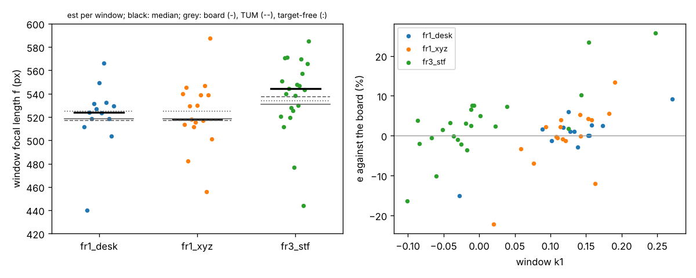

The `sensing-selfcal` programme asks whether a robot camera can recalibrate itself from 1.2 seconds of ordinary video, with no checkerboard. Today's earlier steps added a rolling-shutter term to each window's solve ([milestone 3n](2026-11-18-tum-cameras-have-a-rolling-shutter-and-it-was-in-the-focal-length.md)). They then showed that neither the camera's translation nor a 5 ms timing offset explains the 1.9% to 4.0% median focal error that was left ([milestone 3p](2026-11-18-tum-image-stamps-run-five-milliseconds-behind-the-motion.md)). This step asks a plainer question first: is that error a *bias* at all?

**What we did.** No new solves. We took the same 53 windows from three TUM RGB-D sequences: fr1/desk and fr1/xyz, filmed with a Kinect, and fr3/structure_texture_far, filmed with an Xtion. We scored each window's focal length against three calibrations of the same camera, not just one:

- the flat-board Zhang calibration every earlier step used (Kinect 518.3 px, Xtion 530.7);
- the dataset authors' published intrinsics (516.9 and 537.3, averaging fx and fy);
- a target-free 13-view anchor from milestone 4n (525.2 and 534.0).

Those three disagree by 1.6% on the Kinect and 1.2% on the Xtion. We also checked whether anything a window reports about itself predicts its error: its distortion k1, its solver's standard deviation, its principal point. Seven predictions were written in the log before the analysis code existed.

**What we found.** Four of seven held.

- **On the Kinect there is little bias left.** The windows' median focal length is 524.1 px on fr1/desk and 517.9 px on fr1/xyz. Both sit inside the span of the three references. Single windows scatter much more: a robust standard deviation of 2.1% and 6.0%, against medians of 1.1% and 0.07% off the board.
- **The Xtion keeps a bias.** Its median is 544.2 px, 1.3% to 2.5% above every reference, though the bootstrap interval (527.7 to 565.6) is wide.
- **Where a window lands tracks its own distortion.** On the Kinect, a window's signed error correlates with its k1 at Spearman +0.58. That is the same figure as before the shutter term was added. Within each sequence it is +0.44, +0.60 and +0.72. The principal point's distance from the anchor tracks the size of the error (+0.42).
- **The solver's own uncertainty is a weak guide.** Its correlation with the error is +0.29. Keeping the half of each sequence's windows with the smaller reported uncertainty cut the median error by 22% and 36% on two sequences and raised it on fr1/xyz.
- **A correction does not carry between sessions.** A k1-to-error line fitted on fr1/desk halves fr1/xyz's error (3.96% to 2.12%). The reverse fit makes fr1/desk worse (2.11% to 3.51%). The two lines have different slopes.

**What it means.** In a short window, focal length, distortion and principal point trade off along a ridge, and where a window lands on that ridge sets its error. That is scatter to average down by pooling windows, as milestone 3d did. It is not a missing term to model. Choosing the reference alone moves the pooled headline error from 3.06% to 2.62%. That 0.4 points is as much as any model change since milestone 3n. Any claim below about 1.5% on TUM therefore needs the reference's own uncertainty stated beside it.

**Limits.** 53 windows, three sequences, two cameras. The principal-point reference is the target-free anchor, because the Zhang fit's principal point was not stored. The size gate uses each sequence's own median.

**Next.** A prior on k1 and the principal point drawn from the camera's own earlier windows, rather than a fixed board value (which hurt in milestones 3f to 3j). A second board calibration of the Xtion, to tell whether its high median comes from the windows or the reference.

Code, data and the full log: [`research/sensing-selfcal`](../../research/sensing-selfcal/README.md).
